# Build log

My notes from building two SO-101 robot arms and teaching one of them a task with π0.5, in the order it happened. I've left the mistakes in, because that's where I learned the most.

I did the building, wiring and testing myself. I used [Claude Code](https://claude.com/claude-code), an AI coding assistant, to help me read the LeRobot source, write diagnostic scripts and keep these notes.

## October 3–5: first prints

I started by printing the mount for the motor controller board on my Bambu P1S. The board's brass spacers wouldn't go into the printed holes, so I widened just those four holes. My first try (+0.6 mm) was so loose the spacers slid out. +0.2 mm was snug.

I printed the leader arm's handle standing up instead of on its side, so the support material wouldn't leave marks on the part you hold.

I also installed LeRobot, Hugging Face's robotics library, and made sure it could use my Mac's GPU and handle video before I touched any hardware.

## October 11–12: printing and motors

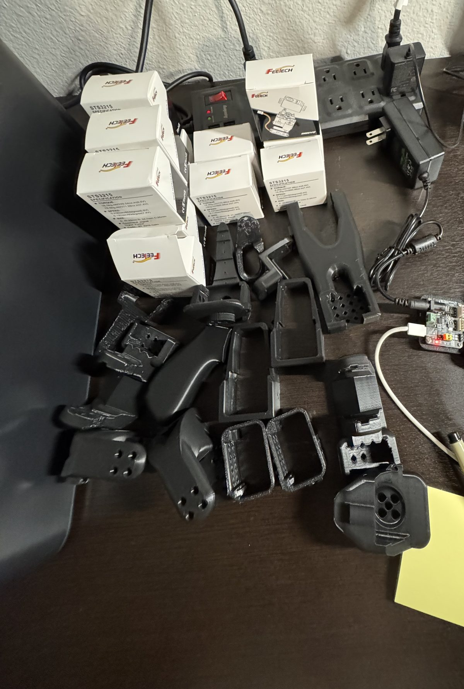

I printed the other 15 parts on four plates, checking against the official parts list so nothing was missing or doubled up.

The two arms use 12 servo motors, and they aren't all the same. The follower uses six with the strongest gearing. The leader, which I move by hand, mixes three gear ratios so it's easy to push around. I sorted them by the labels on their boxes.

Before plugging anything in, I measured the power supply with a multimeter. It read 5.5 V with nothing connected, and the controller board doesn't regulate voltage, so that's exactly what the motors get.

Each motor needs its own ID, set one motor at a time. My first try failed with "motor not found" because I'd only plugged in USB. USB powers the board, but the motors need the separate power supply.

## October 15: a USB error I almost blamed on the wrong thing

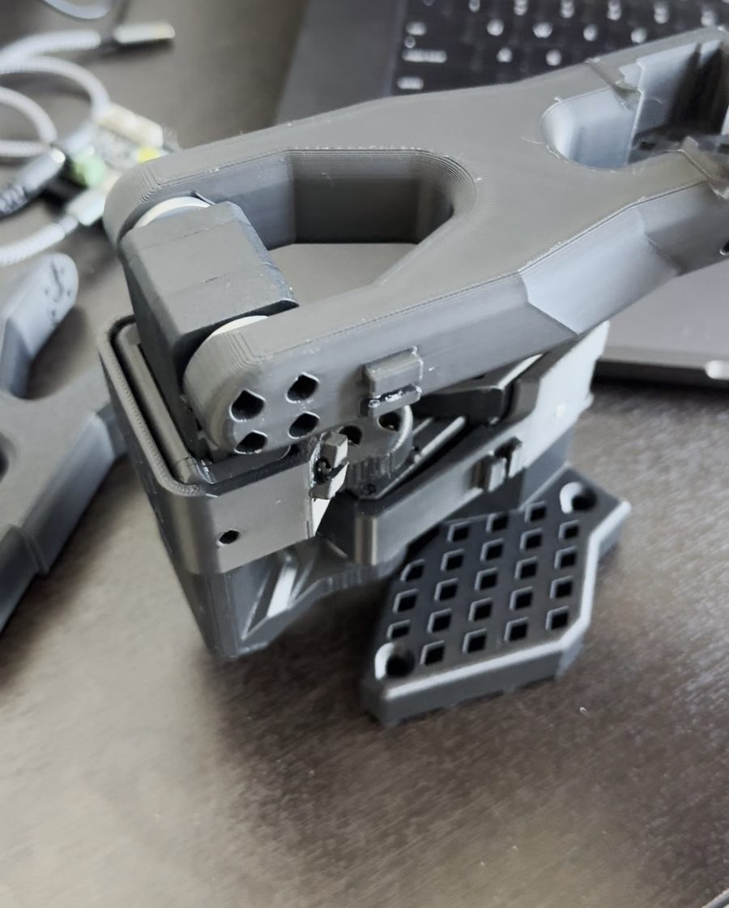

While I was setting up the leader's motors, the program crashed with a "device not configured" error. I'd just switched to a new USB cable and assumed that was the problem. Before throwing it out, I tested both cables on the same setup, and each one passed 50 out of 50 reads. The cable was fine, and the error hasn't come back.

For the rest of the leader's IDs, I used a small routine that refuses to change anything unless exactly one motor answers, then reads the new ID back to make sure it stuck.

## October 18–19: assembly and first teleoperation

I assembled and wired both arms. The first scan missed one of the follower's motors, and after I reseated its cable, both arms found all six motors every time.

The leader's handle didn't fit into its mount, so I widened the slot by 1 mm in CAD and reprinted it.

The first teleoperation, where I move the leader and the follower copies it, was rough. The follower moved slowly, the elbow motor reported an overload when I shut it down, and at startup the wrist moved on its own.

I traced the startup movement to LeRobot's code. It switched the motors on before telling them where to be, so they could jump toward an old target. I changed the order locally, and I fixed shutdown so it releases every motor even if one of them throws an error. I wrote tests that reproduced both bugs before I fixed them.

The slowness was my own fault. I'd added a speed limit as a "safety" measure, and all it did was make the follower lag and fill the screen with warnings. With the official command and no changes, it ran smoothly at about 60 updates a second. Lesson learned: start with the standard setup and change one thing at a time.

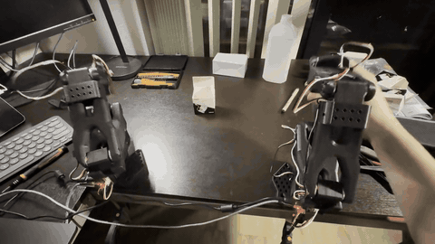

*First teleoperation: I move the leader arm (right) and the follower (left) copies it. [Full clip (MP4)](https://github.com/Jaxsonb04/so101-pi05/raw/main/media/2026-10-19-first-teleop.mp4).*

## October 30: picking it back up

After a week and a half away, I checked all 12 motors before running anything. No faults, and the calibration stored in each motor still matched. The first start failed once with a communication error on the gripper, and running the same command again worked.

## November 4–8: camera mounts

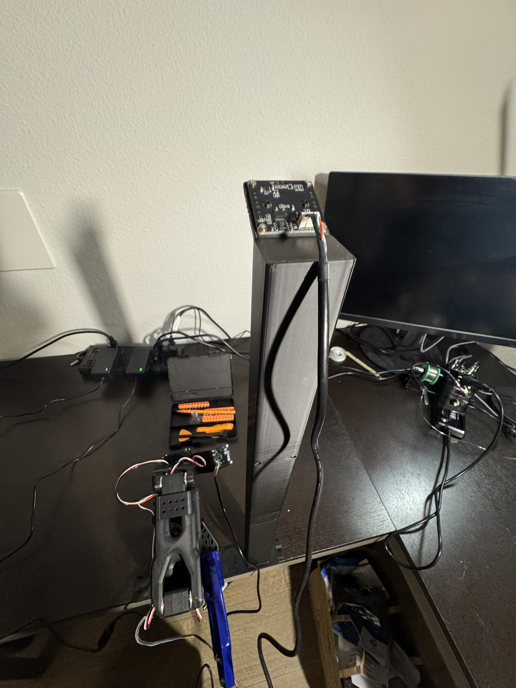

I printed the official overhead camera stand (about 6 hours) and a wrist camera mount that replaces part of the follower's wrist. For the wrist mount, I compared six print orientations for finish, supports and strength before picking one. One plate of the stand failed when the first layer didn't stick, and the reprint came out fine.

## November 6: can my Mac run π0.5?

I timed π0.5 on my M3 Max MacBook. It took about 0.64 seconds to plan the next 1.7 seconds of motion, so the Mac should be able to keep up. That was the bare model with random weights, so real runs will be a little slower.

## November 8: calibration root cause and cameras

### The follower sat a few degrees off the leader

Even after I recalibrated both arms, the follower's base sat a few degrees to the left of the leader's. I also had to redo the leader once, because I'd forgotten to move the gripper during calibration. Checking the saved file caught it.

Reading LeRobot's source explained the offset. A joint's zero isn't the pose you hold at the start of calibration. It's the middle of the range you sweep through. The base can turn a long way in both directions, so how far I happened to swing it each way set its zero, and I'd swung the two arms differently. Their middles were about 7° apart.

I shifted the leader's saved range so the two middles matched, kept a backup, and left the follower's limits alone. Then I posed both arms the same way by hand and measured them: under half a degree apart. The wrist had the same problem, about 22° off, and after the same fix it was within a tenth of a degree.

### Cameras

| Overhead camera | Wrist camera |
| --- | --- |
| 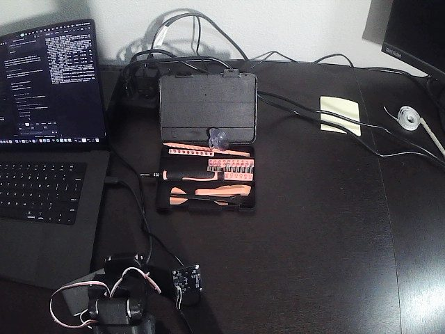 | 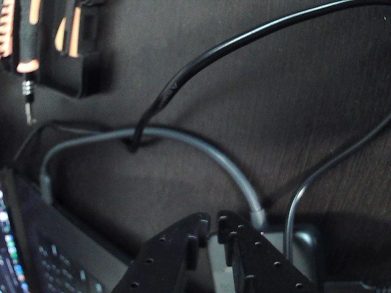 |

At first my Mac found no cameras at all, because the terminal didn't have permission to use them.

Then the first run with both cameras stopped after 20 seconds because one feed went stale. Both cameras share one USB hub, so I blamed bandwidth and tried a compressed video setting. It turned out macOS ignores that setting, so it couldn't have been the fix. I found the real cause later that evening (below).

Looking at saved frames also showed the two cameras were labeled backwards. I fixed that before recording anything. Training with the views swapped would have taught the model the wrong thing.

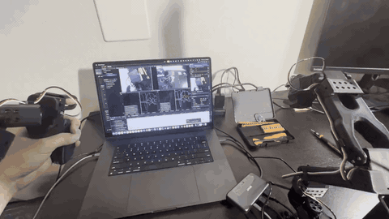

*Teleoperation with both camera feeds and live joint plots on the laptop. [Full clip (MP4)](https://github.com/Jaxsonb04/so101-pi05/raw/main/media/2026-11-08-teleop-with-cameras.mp4).*

## November 8 (evening): recording demonstrations

### Data collection

<table>
  <tr>
    <th width="24%">Teleoperating a demonstration</th>
    <th width="52%">The recording page</th>
    <th width="24%">First replay</th>
  </tr>
  <tr>
    <td align="center">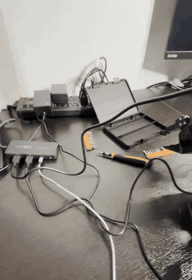</td>
    <td align="center">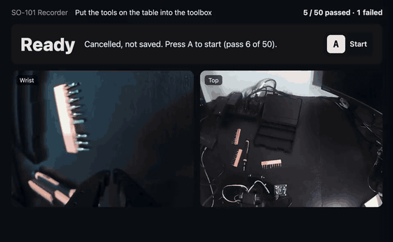</td>
    <td align="center">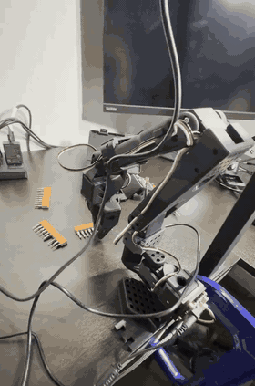</td>
  </tr>
  <tr>
    <td>I move the leader arm and the follower puts a bit strip in the toolbox. <a href="https://github.com/Jaxsonb04/so101-pi05/raw/main/media/2026-11-08-data-collection.mp4">MP4</a></td>
    <td>The recording page, sped up 2×. <a href="https://github.com/Jaxsonb04/so101-pi05/raw/main/media/2026-11-08-recording-page.mp4">MP4</a></td>
    <td>Replaying a recorded take. <a href="https://github.com/Jaxsonb04/so101-pi05/raw/main/media/2026-11-08-first-replay.mp4">MP4</a></td>
  </tr>
</table>

The replay was the first time the follower moved without me driving it. It just repeats the recorded joint motions without looking at the cameras, and I'd moved the toolbox since recording, so it goes through the motions without picking anything up. Getting it to actually do the task is π0.5's job.

### A recording page instead of keyboard shortcuts

LeRobot's recorder is controlled with keyboard shortcuts, and they didn't fit how I wanted to work. I couldn't start a take when I was ready, or mark it as a pass or a fail. Stopping at the wrong moment could also lose a take: I lost a full one-minute take by pressing Ctrl+C during its reset pause.

So I built a small [recording page](tools/record_ui.py) around LeRobot's own recorder. It shows both cameras, and four keys start a take, mark it passed, mark it failed, or throw it away. Failed takes are kept with a label, since they're data too. Only passes count toward the goal, and it picks up where I left off if I stop and restart.

Before I used it on the robot, I had the code reviewed independently against LeRobot's source. That caught three real bugs, including one that would have crashed when resuming a session. I fixed them and added each case to a test that runs without the robot.

### Camera dropouts: the real cause

Recording kept stopping with "latest frame is too old", which just means the wrist camera didn't send anything for half a second.

The macOS system log told the real story. The wrist camera was physically disconnecting and reconnecting about 30 milliseconds later, at the exact moment each recording stopped. It came back so fast that it always looked connected. Over one evening it disconnected 193 times. The overhead camera, on the same hub, disconnected once.

That ruled out my code, since it happened even with nothing running. It also ruled out bandwidth, so my earlier theory was wrong. The problem is the wrist camera's cable or plug (which flexes as the arm moves), its port, or the camera itself. I decided not to add an automatic reconnect, because it would hide the problem without saving the take that got interrupted.

### Checking my own data

Before the real recording, I did 8 test takes and went through each one, looking at frames from both cameras and at the joint data.

Two of the "failed" takes weren't attempts at all, just one to five seconds of nothing, which is why the page now has a throw-away key. The frames also showed problems with the scene: my hand reaching into the overhead view, my laptop screen in the corner (its content changes between takes, which the model could latch onto), a dark image, and orange scraps that looked like the tools. I cleaned all of that up, and from then on only the tools moved between takes.

By the end of the night I had 21 real takes: 19 good and 2 failed.

## November 9: 50 demonstrations, then training

### Finishing the dataset

I recorded the rest of the demonstrations over two evenings and ended up with 52 takes: 50 good and 2 failed. The recording page picked up where I'd left off each time, which is exactly why I built it. The wrist camera kept dropping out, but luckily never in the middle of a take I kept.

Before training anything, I went through every take. All 50 good ones end with all four tools (three bit strips and a screwdriver) in the box. The joint data looked clean too, with no long pauses, no false starts, and every take starting from roughly the same pose. One take runs about twice as long as the rest because the arm missed a grab and went back for it. That's actually useful for the model to see.

One thing I didn't plan for: the toolbox ended up in four different spots across the takes. Most of them (38) are in the same place, so that's where I'll test first.

I also made a mistake in the review. My script jumped to the last frame of each video with a fast seek, which in these files lands a few seconds late. So I was really looking at the start of the next take, and some good takes looked unfinished. Decoding the videos frame by frame fixed it. Lesson learned: don't trust fast seeking on robot video.

### A model my Mac couldn't load

π0.5 is too big to train on a laptop, so training runs in the cloud on Hugging Face Jobs. My first 20-step test run failed almost immediately with a config error. LeRobot's cloud image had been updated to a newer version that same day, and it couldn't read the config my older local version sent it.

Getting around that produced a test model, so I checked whether my Mac could actually load it. It couldn't, because about half the weights had been renamed between versions. Without that check, I'd only have found out when I tried to run it on the arm.

The fix was to make the cloud job install the exact LeRobot and `transformers` versions I run locally before it starts training. The next test model matched my setup exactly. I also switched from an A100 to an H200 GPU, which ran more than twice as fast for twice the price.

### Training

I went with a full fine-tune and turned on image augmentation, since the recordings came from two sessions with different lighting. The run makes about five passes over the data and saves a checkpoint halfway and at the end, so I can try both on the arm. It started around 9 pm and should finish overnight. The training loss is dropping, which is a good sign, but the real test is whether the arm can actually do the task.

## November 10: first runs on the arm, and finding out why it fails

### Training finished, so I checked it before it moved anything

Training finished overnight. Before letting the model drive the arm, I fed it frames from my own recordings on the Mac, the same way the real run does, and compared its planned moves with what I'd actually done. It was off by about 2° on average. Just holding still would have been off by about 16°. So the cameras, the joint order and the task text were all reaching the model correctly.

### First time on the arm

It went for the right things straight away. Then it hovered just above a bit strip, closed on air, went back towards the toolbox as if it were holding something, and tried again, about eight times in a minute. It never picked one up. I filmed it on my phone and went through the video frame by frame.

### A page for scoring trials

LeRobot's scoring mode had two problems for me. It ended each trial by driving my leader arm to the follower's position and then letting go of it, so with nobody holding it, both arms dropped. And it only knows pass or fail. So I wrote an [eval page](tools/eval_ui.py) like my recording page. A starts a trial and B marks a pass. C marks a fail, then it asks how many of the four tools made it into the box. D stops the model and sends the arm home, and M marks a moment I want to look at later. I run it without the leader arm, so the follower goes back to its start pose by itself after every trial.

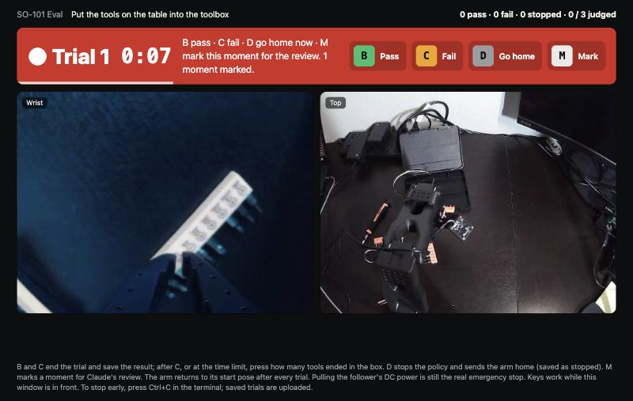

The eval page mid-trial. For this screenshot it's replaying frames from a recorded trial.

### 21 trials with the cameras swapped

My first proper evaluation was 21 trials, and every one failed. When I went through the recordings, the reason wasn't the model at all: the two camera feeds were swapped. The wrist camera had dropped off USB and come back, and macOS gave the two identical cameras each other's numbers. So the model got the overhead view where it expected the gripper's view, and the other way round.

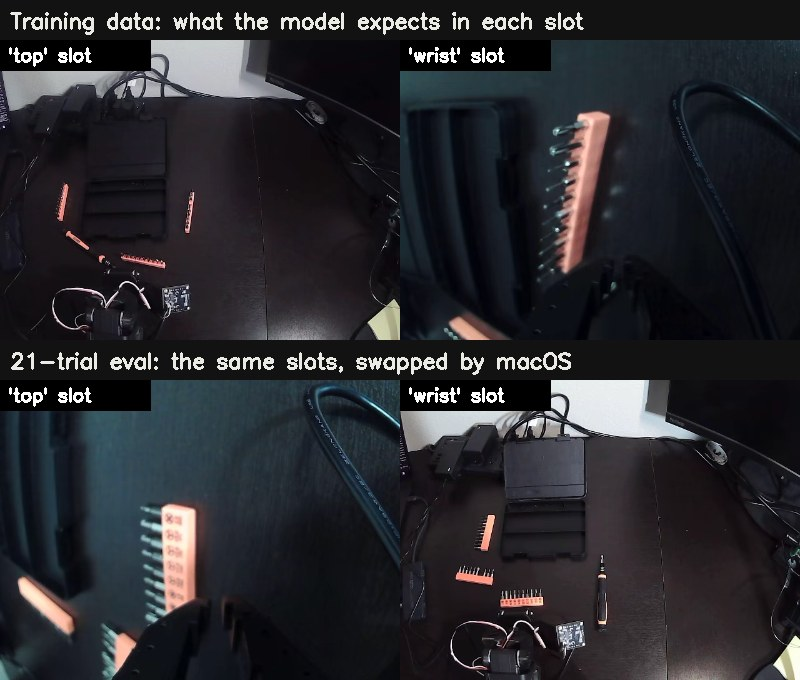

The fix: only the overhead camera can see the bright wall at the top of its picture, so both my pages now compare the two feeds before the arm moves and put them in the right slots. If the picture is ever too unclear to tell, they stop instead of guessing. It kept all 50 of my demos as they were and fixed all 21 swapped trials.

### Smooth mode made it indecisive

Once it could see properly, it swung back and forth between two tools. I'd been using LeRobot's real-time chunking, which plans the next stretch of motion while the arm is still moving. Reading the code showed it replans about every 0.7 seconds and keeps very little of the previous plan. So whenever two tools looked equally good, the model could change its mind every time. In plain mode it carries out each 1.7-second plan before thinking again. In my first five plain-mode trials, 5 of the 20 tools ended up in the box. With real-time chunking it had been none.

### Reviewing every trial

I wanted more out of each trial than pass or fail, so I wrote a [review tool](tools/review_trials.py) that marks every trial's key moments on the camera frames. A pick is when the gripper is told to close but something holds it open, which finds exactly four picks in a typical demo. It also marks each release, any 12 seconds or more without picking anything up (my demos almost never pause that long), and the moments I marked with M. Then I went through every trial and wrote down what happened and why.

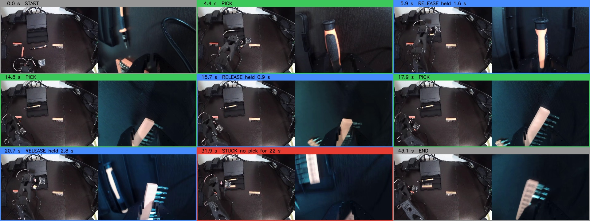

One reviewed trial. At 15.7 s a strip slips out of the gripper, at 17.9 s the model picks it up again, and at 20.7 s it goes in the box.

One thing I had to get straight: drawing on the frames doesn't teach π0.5 anything. It only learns from the raw camera images, the joint angles and the task sentence, and boxes drawn on training frames would just corrupt them. What the review does is tell me exactly which situations need more data. LeRobot also has a correction mode for recording that data: I let the model run, take over with the leader arm when it hesitates, and each takeover is saved as a new training example.

### The halfway checkpoint did better

Training saved a checkpoint halfway as well as at the end, so I ran five trials with each, with the same settings and similar layouts. The final model got 6 of 20 tools into the box. The halfway checkpoint got 11 of 20, and one trial was its first full pass: all four tools in the box, on its own.

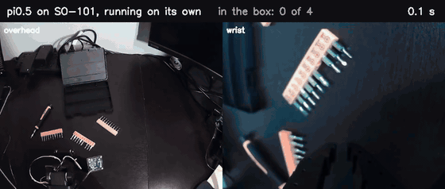

The first full pass, sped up 3×. The pauses while it thinks between moves aren't in the recording. <a href="https://github.com/Jaxsonb04/so101-pi05/raw/main/media/2026-11-10-first-pass.mp4">MP4 (real speed)</a>

My guess is that the longer run started memorising my 50 demos. Next time I'll save checkpoints more often and pick the best one on the arm.

### It fails on the right side of the table

The reviews kept showing the same thing: tools on the right side of the table were never picked up. To check that, I mapped where the tools sat at the start of all 50 demos against which tools the model got into the box.

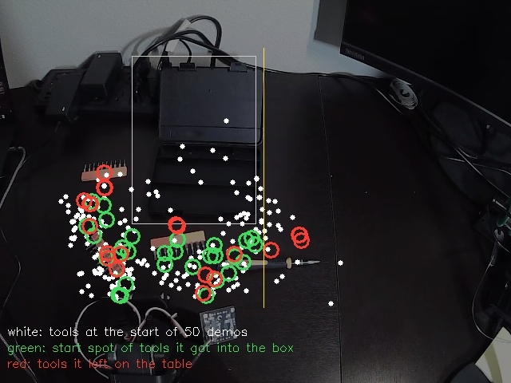

Only 8% of the tool positions in my demos were on the right side. Every tool it got into the box came from the left and centre, where the demos are dense. So the model isn't broken; I just never showed it the right side of the table.

### Smaller things

- The wrist camera's plug was loose at the camera end. I reseated it, but the camera still dropped twice that evening.
- After I interrupted a run while the model was loading, the old process kept running in the background and blocked the next one. The pages now say so plainly.
- I dropped voice commands from the plan. Getting the task itself reliable comes first.

## November 11: filling the gaps, checking every episode, retraining

### The wrist camera: it's the cable

Securing the plug didn't fix the dropouts: a 10-minute test still dropped after 80 seconds. Swapping the two cameras between hub sockets settled it, because ***the drops followed the wrist camera, not the socket***. So it's that camera's cable or plug, and a new cable is on the list. Until then a drop just ends the episode being recorded, and the page picks up where it left off.

### 103 new demos where the model failed

Two batches. First, tools on the right and front right of the box, where the first model never got a tool. Then tools left of and in front of the box, plus touching tools and strips at different angles. Every demo follows ***one routine***: screwdriver first, one tool at a time, straight to each tool, a slow straight-down grasp.

The scene changed a little too. I took the cables and power strip out of the overhead view, and put the toolbox back on its exact spot from the old demos (lined up against an outline from an old frame), then taped it.

### A bug that would have spoiled 27 demos

A wrist camera drop crashed the recording page and the arm went limp. When the page restarted, the wrist camera happened to face the wall, and my camera check (which looks for the bright wall) put the two views in each other's slots. ***27 episodes were recorded swapped.***

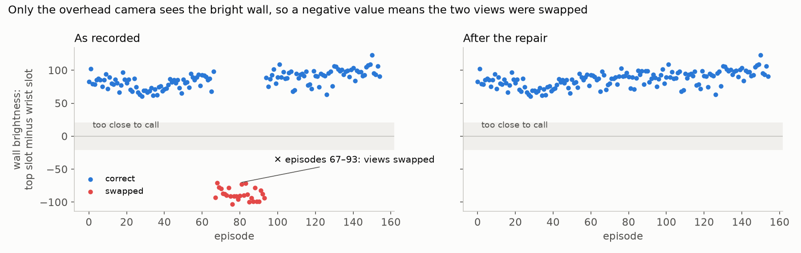

I found them by running the wall test on every episode. They didn't need re-recording: I copied their videos into the right camera folders and pointed those episodes at the copies. The recording page now rechecks the cameras every time A is pressed, when the arm is in its start pose.

### Checking every episode

Training is expensive, so every episode was checked before training. Each limit comes from the old 50 demos' worst 5%: a hover of 3 s or more, more than 13 s with no tool in hand, or more than 2 grabs at nothing. On top of that, each episode needs the right scene and box spot, the screwdriver first, one tool at a time, and all four tools in the box. Every frame was also checked for camera freezes, joint glitches and dropped frames.

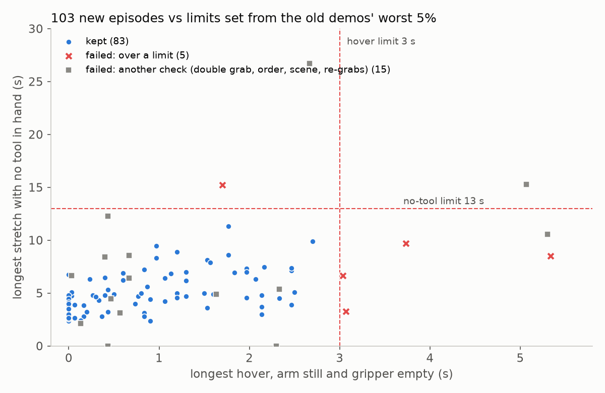

One lesson: a thin strip is pinched by its edge, so a gripper holding one reads almost the same as an empty gripper. My first grasp counter called those grabs at nothing and wrongly failed six good demos. Counting by arm travel fixed it: a close that travels is a carry, a close that stays put is a miss.

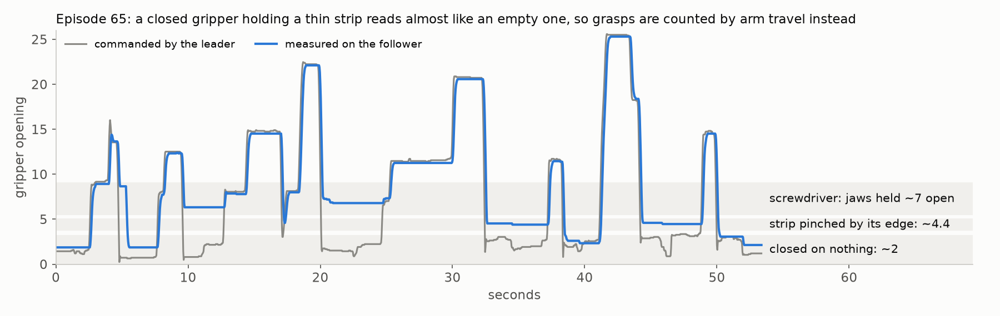

Double grabs were caught by counting the tools left on the table after each trip, then confirmed in the wrist view.

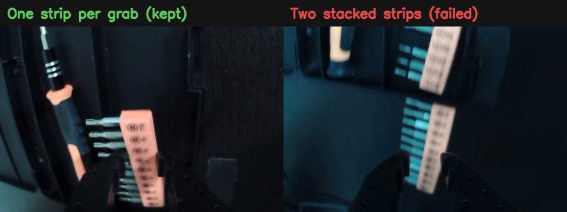

Of the 103 new episodes, 83 passed. Two old ones failed too, both double grabs.

### Picking the training set

My first pick kept only the old demos that also started with the screwdriver. That threw away most of the examples left of the box, so I cancelled that run after 5 minutes. The final set keeps every old demo with the box on its spot, whatever the tool order: 37 old plus 83 new, ***120 demos***.

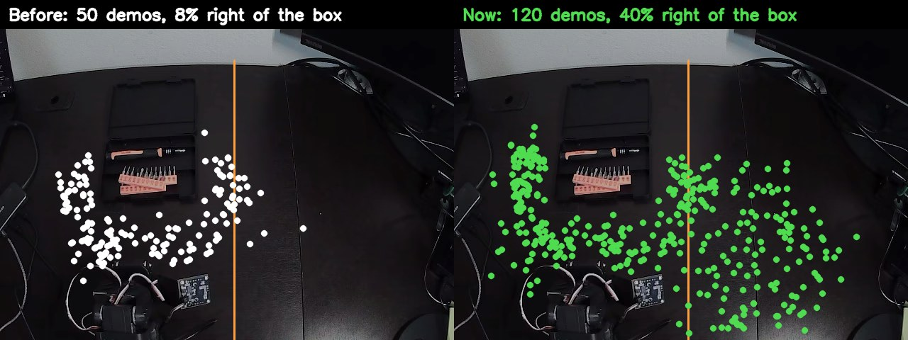

### Retraining

A training run costs about $37 on a rented H200, so before starting I compared the cloud copy of the dataset byte for byte with the files I'd checked. I also ran the job script on my Mac with stand-ins for the GPU parts, which caught a cleanup timer that outlived the job. A second bug slipped through: a cleanup command lost its quote marks on the way to the cloud, so the running job deletes no old checkpoints. That's harmless here because the job has 3 TB of disk, and the script in `tools/` is fixed. Each checkpoint with its optimizer state is 24.5 GB, so the job uploads only the model part of the last three (9,000, 10,000 and 11,000 steps). It's training now: 120 episodes, about 2.8 passes over the data, about 7 hours.

## November 12: the retrained model on 20 fixed layouts

### A fair test

Training finished overnight: 11,000 steps, with the loss ending at 0.013 like the first run, and the last three checkpoints uploaded. To compare checkpoints fairly, each one gets ***the same 20 tool layouts, in the same order***: 5 near the box on the left and front (like the first demos), 5 on the right (where the first model never got a tool in), 4 far left, and 6 mixed or hard ones, such as touching tools or a tool in every corner. The rules are the same for every trial: hands off, 90 seconds, and a pass only when all four tools are in the box.

The recordings give the layouts for free. Every trial starts with the arm at its start pose, so ***its first overhead frame is a picture of the layout***. I set up the next checkpoints from those frames. I took screenshots at first, which was slower, and one caught the arm mid-move.

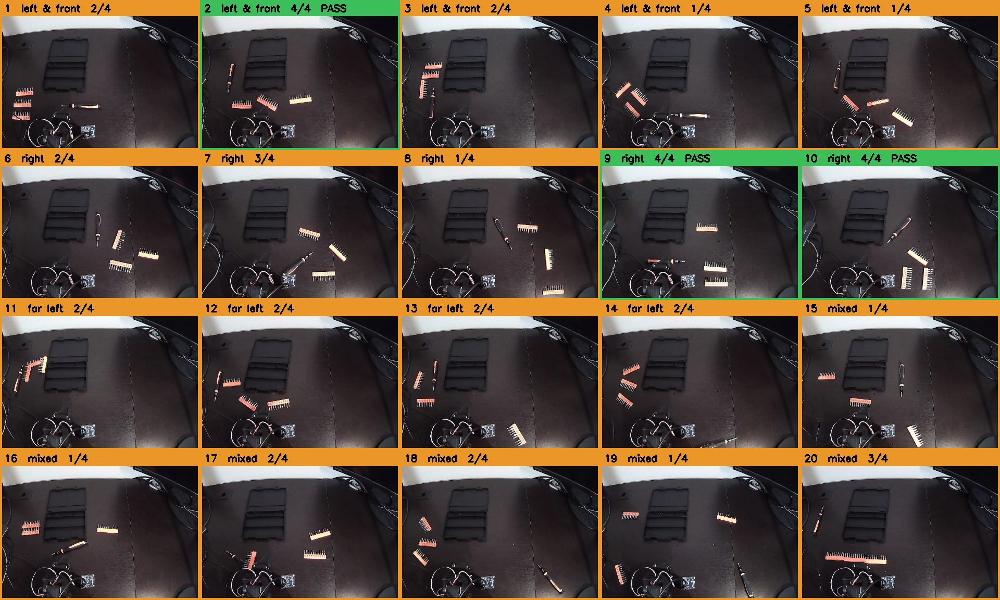

### Results: the 11,000-step checkpoint

<ins>**3 of 20 passes, 42 of 80 tools in the box, 2.1 per trial.**</ins> The first model got 2.2 per trial on easier layouts, so 2.4× the data didn't move the overall score.

| Zone | Layouts | Tools in the box | Passes |
| --- | --- | --- | --- |
| Left and front | 1–5 | 10 / 20 | 1 |
| **Right** | 6–10 | **14 / 20** | **2** |
| Far left | 11–14 | 8 / 16 | 0 |
| Mixed and hard | 15–20 | 10 / 24 | 0 |

***The right side is fixed.*** The first model never got a tool in from there. Now it's the best zone.

### Every failure is the same

All 17 failures end the same way. After the first one to three tools, the arm hovers over a strip right in front of its jaws and closes on air, again and again, for the rest of the trial: 40 seconds is typical, and one went 61. Failed trials had 19 to 35 gripper closes, passes 12 to 20. The screwdriver usually made it in; the strips are what was left. The first model failed the same way on November 10.

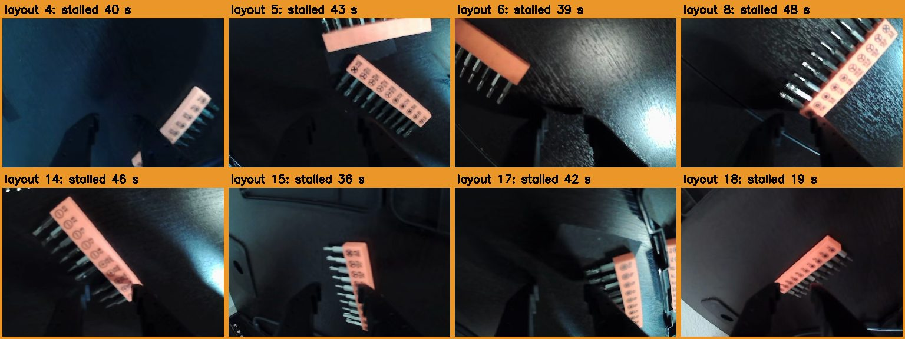

### Problems noticed

- **The strip stall,** above. Most stalls happen on the left, often over strips near the box's left edge or near the arm's base.
- **The arm pushed the toolbox** out of place in at least 2 trials, which spoils the rest of the trial.
- **Two crashes ended eval runs,** and the page restarted its count at zero each time. Every trial was still saved, but keeping track of the layout number by hand was error-prone. The eval page now has `--continue`: it counts the trials already saved for that checkpoint and shows the next layout number. I didn't capture what caused the crashes.
- **A 90-second trial records about 65 seconds of video** in plain mode, because the arm pauses while the model computes its next moves.
- **The wrist camera cable** still needs replacing.

### Takeaways

1. More data fixed the spot it was aimed at, the right side, but didn't raise the overall score.
2. The bottleneck is one skill: finishing a strip grasp. A different checkpoint is unlikely to fix that, since all three come from the last 20% of training.
3. The fix is data at the moment of failure: corrections where it hovers over a strip, then a retrain.

## November 13: a second checkpoint, and a tie

### The 10,000-step checkpoint on the same 20 layouts

I set up the same 20 layouts from the first-frame pictures and ran the 10,000-step checkpoint with the same rules. Afterwards I checked every trial's first frame against its layout picture: all 20 match.

<ins>**As labelled: 3 of 20 passes, 43 of 80 tools. Counted fairly: 2 passes, 42 of 80.**</ins> The 11,000-step checkpoint got 3 passes and 42 of 80. ***The two checkpoints tie.***

The fair count is lower because of my own slip. Layout 20 started with the screwdriver still in the box from the trial before, so the arm only had three tools to move. I found it in the review, from the trial's first frame.

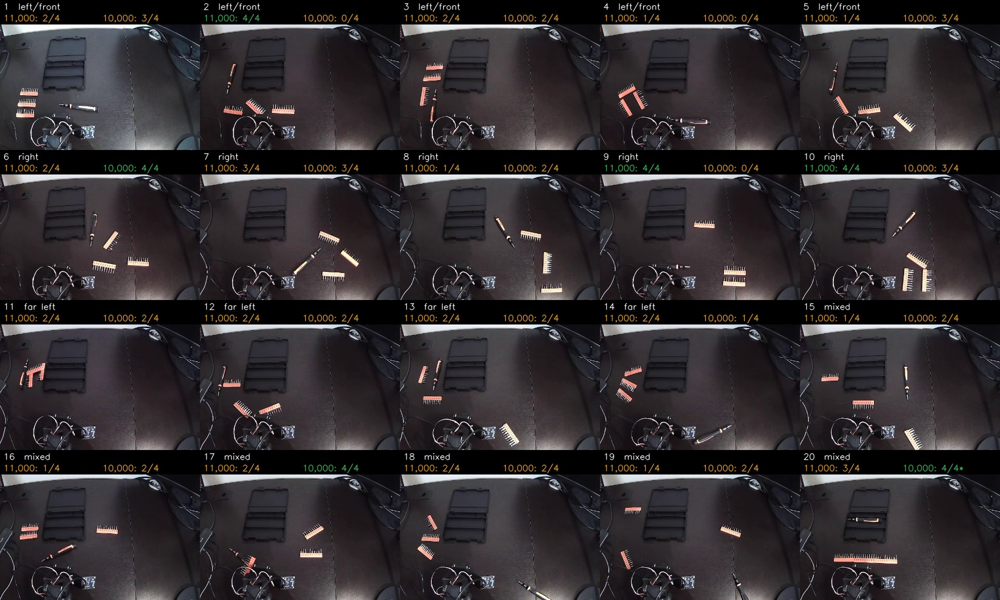

| Zone | Layouts | 10,000 steps | 11,000 steps |
| --- | --- | --- | --- |
| Left and front | 1–5 | 8 / 20 | 10 / 20 |
| Right | 6–10 | 12 / 20 | 14 / 20 |
| Far left | 11–14 | 7 / 16 | 8 / 16 |
| Mixed and hard | 15–20 | 15 / 24 (fair count) | 10 / 24 |

### The same layout, a different result

***Only 6 of the 19 fair layouts got the same score from both checkpoints.*** Layouts 2 and 9 were passes for 11,000 and scored 0 for 10,000. Layouts 6 and 17 went the other way, from 2 tools to a pass. With one trial per layout, a gap of a few tools in 80 can't rank two models. The totals agree, the individual trials don't.

### Reviewing every trial

I went through all 20 trials: the start frame, both cameras at the longest stall, the end frames, and eight frames across each trial.

**What went well**

- Two clean passes, layouts 6 and 17, in about 60 seconds each with no long stall. Layout 17 has a strip touching the screwdriver.
- The right side held up: 12 of 20.
- The eval ran more smoothly: 1 stopped trial against 4 the night before, and `--continue` kept the count across three runs.

**What didn't**

- ***All 17 failures still contain a long stall:*** 19 to 65 seconds, 40 typical, the same as 11,000. The arm hovers over a tool and closes on air.
- ***It isn't only strips.*** In 5 of the 19 fair trials the arm went for the screwdriver and never held it. Those trials scored 0, 0, 0, 2 and 2. In two of them it didn't hold a single tool in the whole trial. Those screwdrivers were close to the arm's base, at the far edges, or right beside the box.
- **When the first grasp fails, the trial is usually lost.** The arm rarely gives up and moves to another tool.
- **The arm pushed the toolbox in 2 trials,** both while going after the screwdriver.
- **Sloppy drops:** in 4 trials a strip ended on the box's rim or just beside it.
- **One trial wasn't saved.** Layout 4's label was written but its recording wasn't, so my layout count was off by one until I compared first frames and redid it.

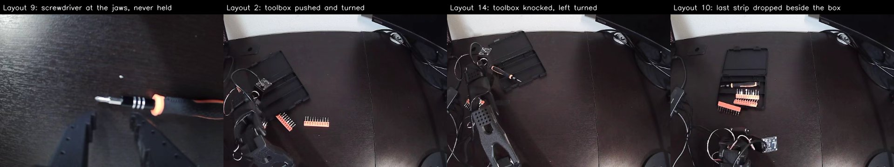

### Takeaways

1. **Checkpoint choice doesn't matter here.** Two checkpoints 1,000 steps apart tie, and both stall the same way.
2. **The failure is "a grasp that doesn't finish, and no plan B",** on the screwdriver as well as the strips.
3. **One trial per layout is too noisy to compare models.** Fewer layouts with repeats, such as 5 layouts × 4 trials, would show whether a result repeats.
4. **Check the table before every trial:** box empty, four tools out, box on its tape.

## Next

1. Decide whether the 9,000-step checkpoint is worth 20 more trials, now that two checkpoints tie.
2. Record corrections where the arm stalls (DAgger): strips at the box's left edge and near the base, and the screwdriver near the base, beside the box and at the far edges. Add demos that back off after a miss. Then retrain.
3. Test the next model on fewer layouts with repeats.
4. Replace the wrist camera cable.
