<h1 align="center">SO-101 → π0.5: a robot arm that tidies tools</h1>

  Two 3D-printed robot arms. One learns to put tools in a toolbox. 
  <b>First full run on its own: four tools, no help.</b>

  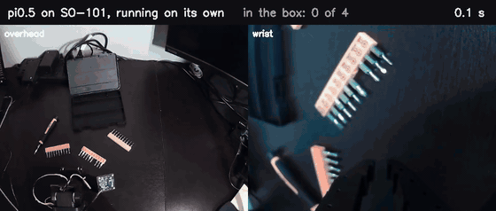 
  Sped up 3×, pauses between moves cut. <a href="https://github.com/Jaxsonb04/so101-pi05/raw/main/media/2026-11-10-first-pass.mp4">MP4 at real speed</a>

  <a href="#status">Status</a> ·
  <a href="#latest-results">Latest results</a> ·
  <a href="#first-results">First results</a> ·
  <a href="#recording-demonstrations">Recording</a> ·
  <a href="#checking-the-data">Data checks</a> ·
  <a href="#problems-solved">Problems solved</a> ·
  <a href="#the-build">Build</a> ·
  <a href="BUILD_LOG.md">Build log</a> ·
  <a href="RUNBOOK.md">Runbook</a>

## In short

- ***Built:*** two [SO-101](https://github.com/TheRobotStudio/SO-ARM100) arms (a leader moved by hand, a follower that copies it) and two cameras.
- ***Taught:*** 50 demonstrations, then fine-tuned [π0.5](https://www.physicalintelligence.company/blog/pi05) with [Hugging Face LeRobot](https://github.com/huggingface/lerobot).
- ***Fixed the data:*** 103 more demos where it failed, every episode checked, <ins>**120 kept for retraining**</ins>.
- ***Retrained and tested:*** two checkpoints on 20 fixed layouts, <ins>**a tie at 42 of 80 tools in the box**</ins> (3 and 2 full passes). The right side is fixed; every failure stalls on a grasp.

## Status

Updated November 13, 2026.

| Step | Status |
| --- | --- |
| Print, wire and assemble both arms | ✅ Done |
| Calibrate and teleoperate | ✅ Done |
| Wrist and overhead cameras | ✅ Done |
| Recording tool | ✅ Done |
| 50 demonstrations | ✅ Done |
| Fine-tune π0.5 | ✅ Done |
| Run on the arm | ✅ First full pass |
| Scoring and review tools | ✅ Done |
| More data where it fails | ✅ 103 new demos |
| Check every episode | ✅ 120 kept |
| Retrain on 120 demos | ✅ Done |
| Score 20 fixed layouts | ✅ 3 of 20 passes (11,000 steps) |
| Score a second checkpoint | ✅ A tie (10,000 steps) |
| Review every trial | ✅ Done |
| Corrections where it stalls | ⏳ Next |

> [!NOTE]
> The wrist camera still drops off USB at times, and macOS can then swap the two cameras' numbers. The tools detect this and fix it before the arm moves.

## Latest results

<ins>**The retrained model, 11,000 steps: 3 of 20 passes, 42 of 80 tools in the box (2.1 per trial).**</ins> The first model got 2.2 per trial on easier layouts. Details in the [build log](BUILD_LOG.md#november-12-the-retrained-model-on-20-fixed-layouts).

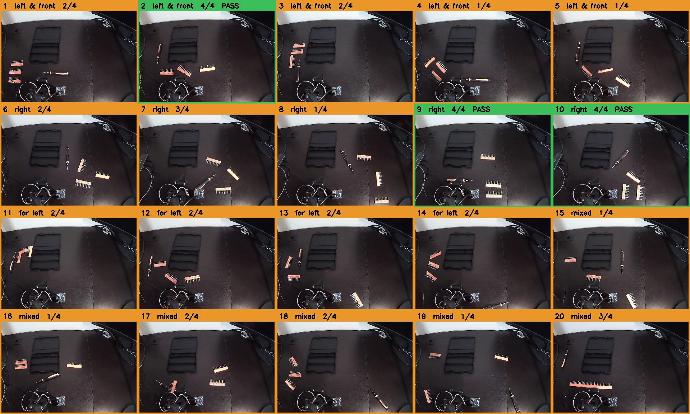

Every checkpoint gets the same 20 layouts in the same order. <b>Each trial's first frame is the layout picture</b>, so no photos are needed.

| Zone | Tools in the box | Passes |
| --- | --- | --- |
| Left and front | 10 / 20 | 1 |
| **Right** (the first model's blind spot) | **14 / 20** | **2** |
| Far left | 8 / 16 | 0 |
| Mixed and hard | 10 / 24 | 0 |

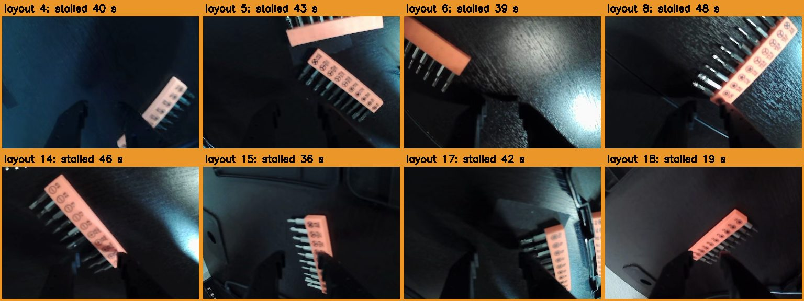

<b>All 17 failures end like this:</b> a strip right at the jaws, the gripper closing on air for the rest of the trial (40 s typical).

***Takeaways:***
- **More data fixed its target, the right side,** but didn't raise the overall score.
- **The bottleneck is one skill: finishing a grasp.** Mostly strips, and for the second checkpoint the screwdriver too.
- **Problems noticed:** the stall clusters on the left, the arm pushed the toolbox in 2 trials, and two crashes reset the eval count, now fixed with `--continue`.

### A second checkpoint: a tie

<ins>**The 10,000-step checkpoint on the same 20 layouts: 2 fair passes, 42 of 80 tools.**</ins> It was labelled 3 passes and 43 tools, but one trial started with the screwdriver already in the box. Every trial was reviewed afterwards. Details in the [build log](BUILD_LOG.md#november-13-a-second-checkpoint-and-a-tie).

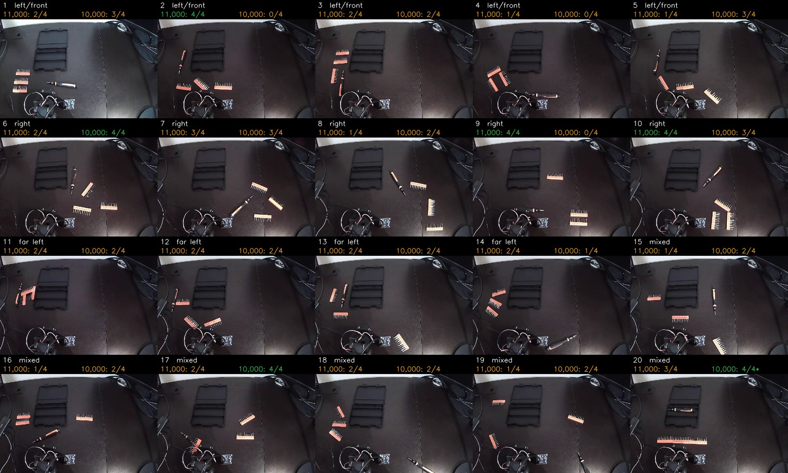

<b>Same layouts, different results:</b> only 6 of the 19 fair layouts got the same score from both checkpoints.

- **Checkpoint choice doesn't matter.** Both stall the same way: every failure contains a long stall, 40 s typical.
- **It isn't only strips.** In 5 trials the arm went for the screwdriver and never held it; those scored 0, 0, 0, 2 and 2.
- **One trial per layout is too noisy.** Two layouts went from a pass to 0, two others from 2 tools to a pass.
- **Also seen:** the toolbox pushed in 2 trials, and strips dropped on the box's rim in 4.
- ***Next:*** record corrections where it stalls, add demos that back off after a miss, retrain, and test with repeats.

## First results

<ins>**11 of 20 tools in the box over 5 trials, including one full pass.**</ins> Not reliable yet. Every failure is recorded and reviewed.

<table>
  <tr>
    <th width="50%">Scoring page</th>
    <th width="50%">Annotated review</th>
  </tr>
  <tr>
    <td align="center">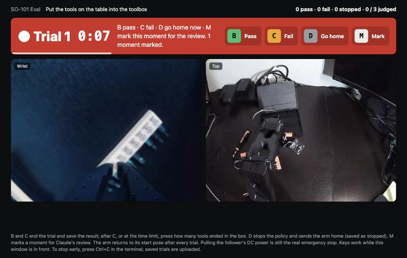</td>
    <td align="center">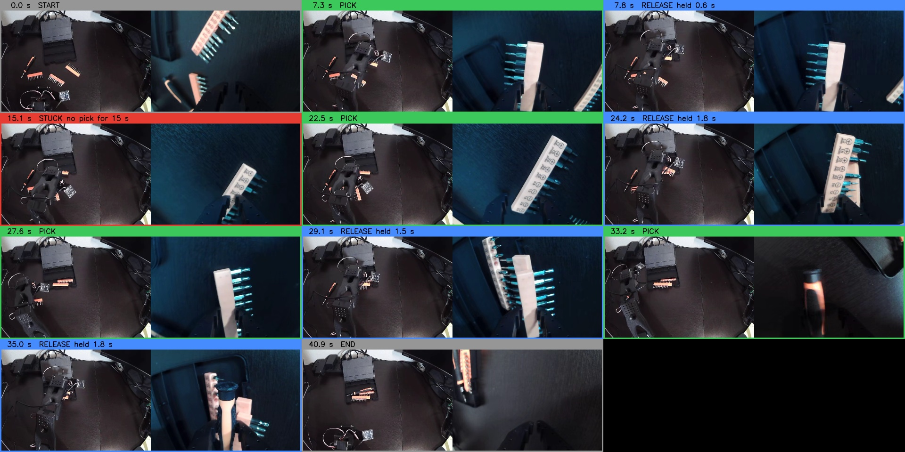</td>
  </tr>
  <tr>
    <td><b>A</b> start · <b>B</b> pass · <b>C</b> fail + tool count · <b>D</b> go home · <b>M</b> mark a moment. The arm resets after every trial. <a href="tools/eval_ui.py">Code</a></td>
    <td>Every pick, release and long pause marked on the frames, from the gripper's readings. <a href="tools/review_trials.py">Code</a></td>
  </tr>
  <tr>
    <th>Where it fails</th>
    <th>The bug that made it look blind</th>
  </tr>
  <tr>
    <td align="center">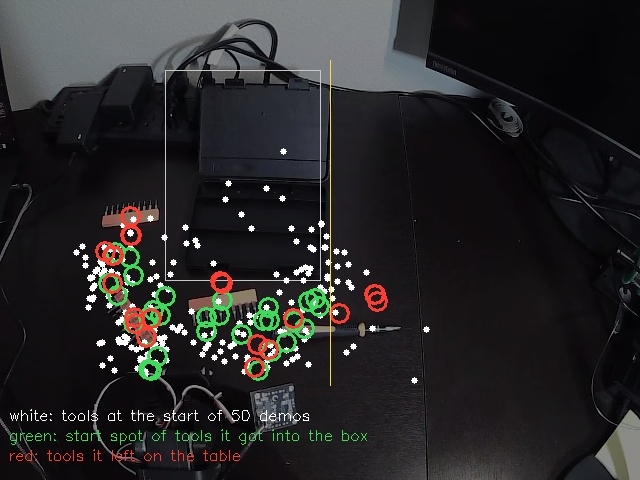</td>
    <td align="center">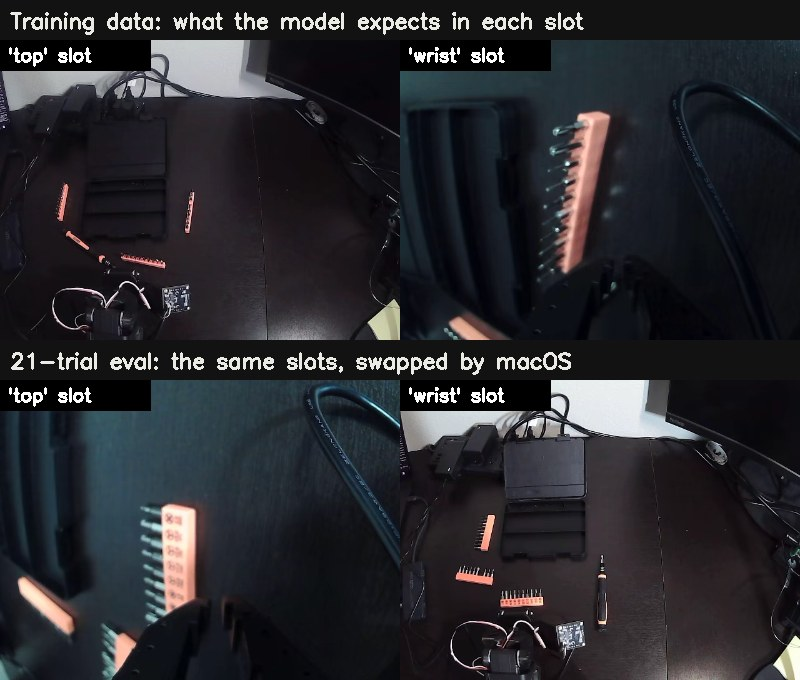</td>
  </tr>
  <tr>
    <td>White = demo tool spots · green = put in the box · red = left behind. <b>Only 8% of demo spots were on the right; nothing from there went in.</b></td>
    <td>For 21 trials the two camera views were swapped. macOS renumbered the identical cameras after a USB dropout.</td>
  </tr>
</table>

### The full pass, raw

<ins>**Trial 2 of 5, 3,500-step checkpoint: all four tools in the box at 40.9 s.**</ins>

- 🎥 ***[Raw video](https://github.com/Jaxsonb04/so101-pi05/raw/main/media/2026-11-10-first-pass-raw.mp4)***: overhead and wrist cameras exactly as the robot saw them, real speed, no edits or labels.
- 📈 ***[Joint data (CSV)](media/2026-11-10-first-pass-joints.csv)***: all six joints, measured and commanded, 30 times per second (1,229 rows).

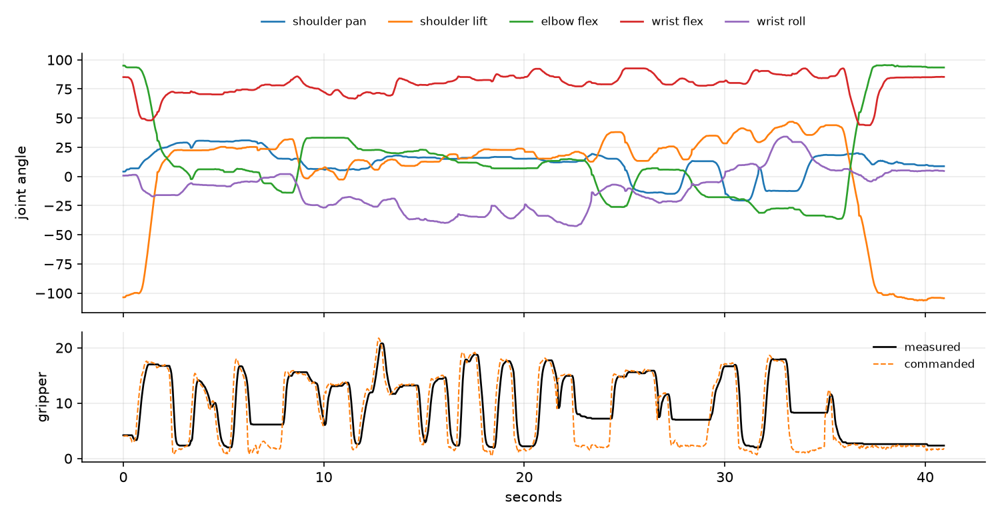

<b>Bottom chart:</b> where the black line stays above the orange one, the gripper is closed on a tool. <b><i>Four holds = four tools.</i></b>

***Then:*** data for the spots it missed and a retrain, in [Latest results](#latest-results). Details in the [build log](BUILD_LOG.md#november-10-first-runs-on-the-arm-and-finding-out-why-it-fails).

## Recording demonstrations

<table>
  <tr>
    <th width="24%">Teleoperating a demo</th>
    <th width="52%">The recording page</th>
    <th width="24%">First replay</th>
  </tr>
  <tr>
    <td align="center">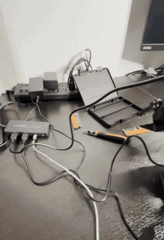</td>
    <td align="center">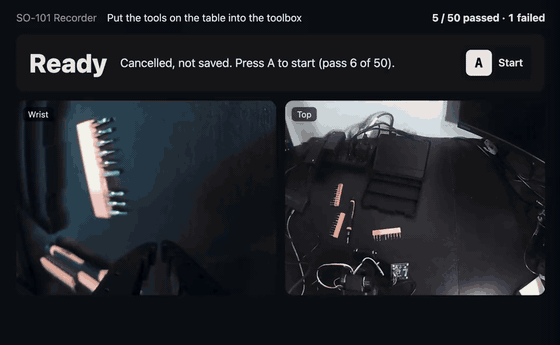</td>
    <td align="center">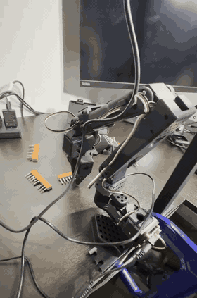</td>
  </tr>
  <tr>
    <td>The follower copies the leader. <a href="https://github.com/Jaxsonb04/so101-pi05/raw/main/media/2026-11-08-data-collection.mp4">MP4</a></td>
    <td>Sped up 2×. <a href="https://github.com/Jaxsonb04/so101-pi05/raw/main/media/2026-11-08-recording-page.mp4">MP4</a></td>
    <td>Replay only repeats motions; no cameras. <a href="https://github.com/Jaxsonb04/so101-pi05/raw/main/media/2026-11-08-first-replay.mp4">MP4</a></td>
  </tr>
</table>

A small [recording page](tools/record_ui.py) replaces LeRobot's keyboard shortcuts: ***one key starts a take, others mark pass, fail or redo***. It resumes where it left off. Commands: [runbook](RUNBOOK.md#4-record-demonstrations).

## Checking the data

Training runs on a rented cloud GPU and is ***expensive*** (about $37 a run), so <ins>**every episode was checked before training**</ins>: every frame, the joints, and a look at each one. Details in the [build log](BUILD_LOG.md#november-11-filling-the-gaps-checking-every-episode-retraining).

<table>
  <tr>
    <th width="50%">Where the tools started</th>
    <th width="50%">Every new episode vs the limits</th>
  </tr>
  <tr>
    <td align="center">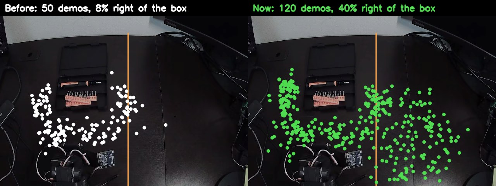</td>
    <td align="center">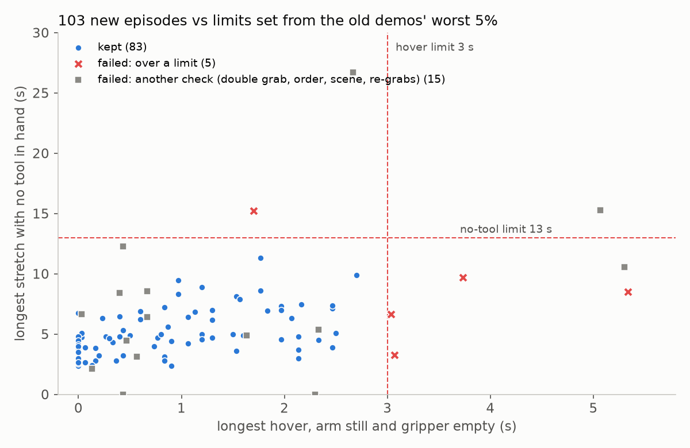</td>
  </tr>
  <tr>
    <td><b>8% → 40%</b> of tools right of the box, the spot the first model never solved.</td>
    <td>Limits from the old demos' worst 5%. <b>83 of 103 kept</b>; the rest hovered, searched, grabbed two tools, or broke the routine.</td>
  </tr>
  <tr>
    <th>Finding swapped cameras</th>
    <th>Strip grasp or miss?</th>
  </tr>
  <tr>
    <td align="center">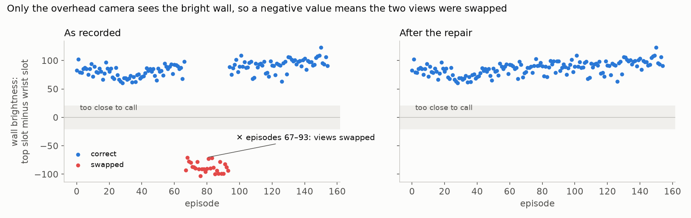</td>
    <td align="center">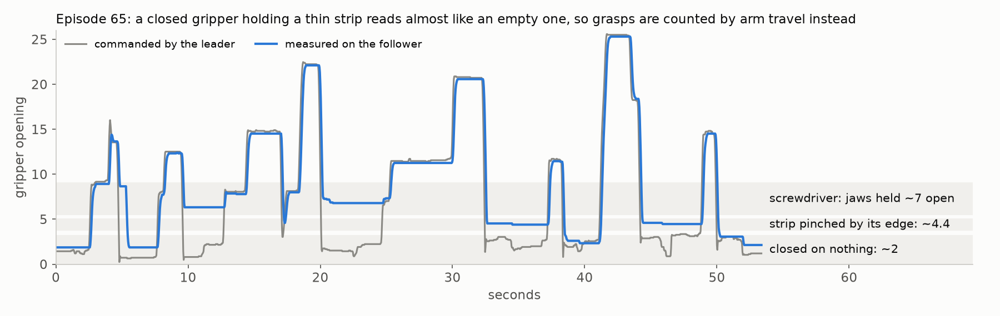</td>
  </tr>
  <tr>
    <td>Only the overhead camera sees the bright wall. <b>27 episodes</b> were recorded swapped, then repaired without re-recording.</td>
    <td>A strip held by its edge reads almost like an empty gripper, so grasps are counted by <b>arm travel</b>, not jaw opening.</td>
  </tr>
</table>

## Problems solved

Full story in the [build log](BUILD_LOG.md).

- **21 failed trials: <ins>cameras swapped, not a bad model.</ins>** After a USB dropout macOS swapped the two identical cameras. The pages now compare the feeds (only the overhead sees the wall) and fix the order.
- **Indecisive arm: <ins>smooth mode replanned too often.</ins>** Real-time mode switched targets every ~0.7 s. Plain mode commits for 1.7 s: ***0 → 5 of 20 tools.***
- **More training was worse: <ins>overfitting and a data gap.</ins>** Halfway checkpoint 11 of 20, final 6 of 20. Only 8% of demo tool spots were on the right.
- **Wrist camera cutouts: <ins>a cable, not bandwidth.</ins>** The macOS log showed ~200 physical disconnects in one evening, on that camera only.
- **Cloud model wouldn't load: <ins>version mismatch.</ins>** A cheap test job caught renamed weights in a newer LeRobot. Pinning the cloud to the Mac's versions fixed it.
- **Arms didn't line up: <ins>uneven calibration sweeps.</ins>** A joint's zero is the middle of its swept range. Matching the sweeps cut the gap from ~7° to under 0.5°.
- **Startup lurch: <ins>motors on before a target was set.</ins>** Fixed the order; tests reproduce the bug first.
- **27 demos recorded swapped: <ins>a limp arm fooled the camera check.</ins>** After a crash the wrist camera faced the wall at restart. Found with a wall test on every episode, repaired without re-recording; the page now rechecks at every take.
- **Good grasps counted as misses: <ins>thin strips.</ins>** A strip pinched by its edge leaves the jaws almost shut. Counting by arm travel instead restored 6 wrongly failed demos.
- **A training set that lost the left side: <ins>too strict a filter.</ins>** Keeping only old demos with the same tool order dropped most left-side examples. Keeping every old demo with the box on its spot fixed it.
- **A costly run is checked before it starts.** The cloud copy is byte-compared with the checked files, and the job script is run locally with stand-ins first. That caught a cleanup timer that outlived the job.
- **Data checked before training.** Caught a hand and a laptop screen in view, and a frame bug in the review script.
- **Eval count reset after a crash: <ins>each run gets its own folder.</ins>** The eval page now counts the earlier runs of the same checkpoint and shows the next layout number.
- **A pass that wasn't: <ins>a tool left in the box.</ins>** One trial started with the screwdriver still in the box from the trial before. Found from the trial's first frame; the runbook now has a table check before every trial.
- **Layout photos: <ins>the recording already has them.</ins>** Each trial starts with the arm at its start pose, so its first overhead frame is the layout picture. No screenshots needed.

## The build

<table>
  <tr>
    <th>Printing</th>
    <th>Motor bring-up</th>
    <th>Assembly</th>
    <th>Camera stand</th>
  </tr>
  <tr>
    <td align="center">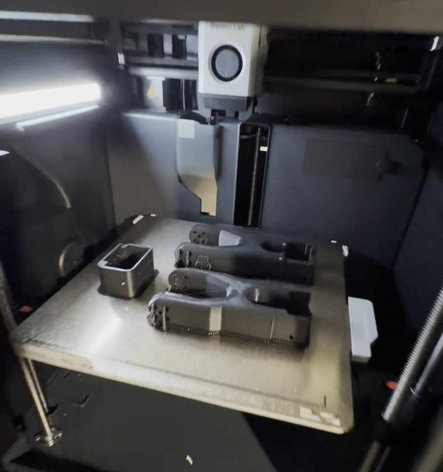</td>
    <td align="center">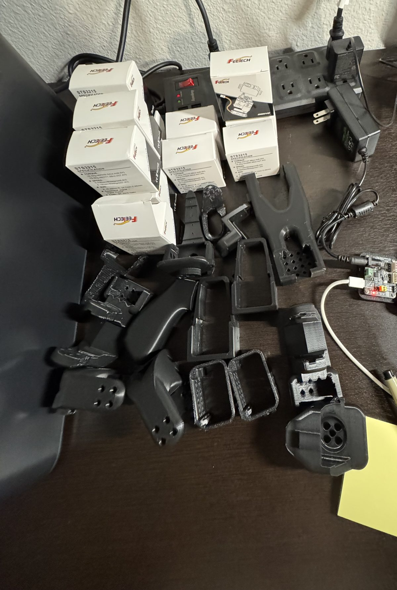</td>
    <td align="center">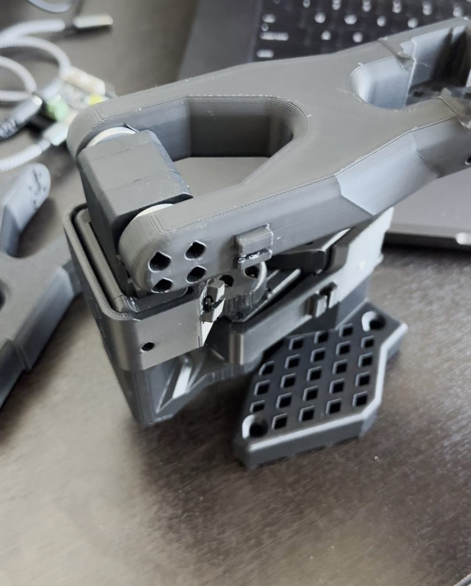</td>
    <td align="center">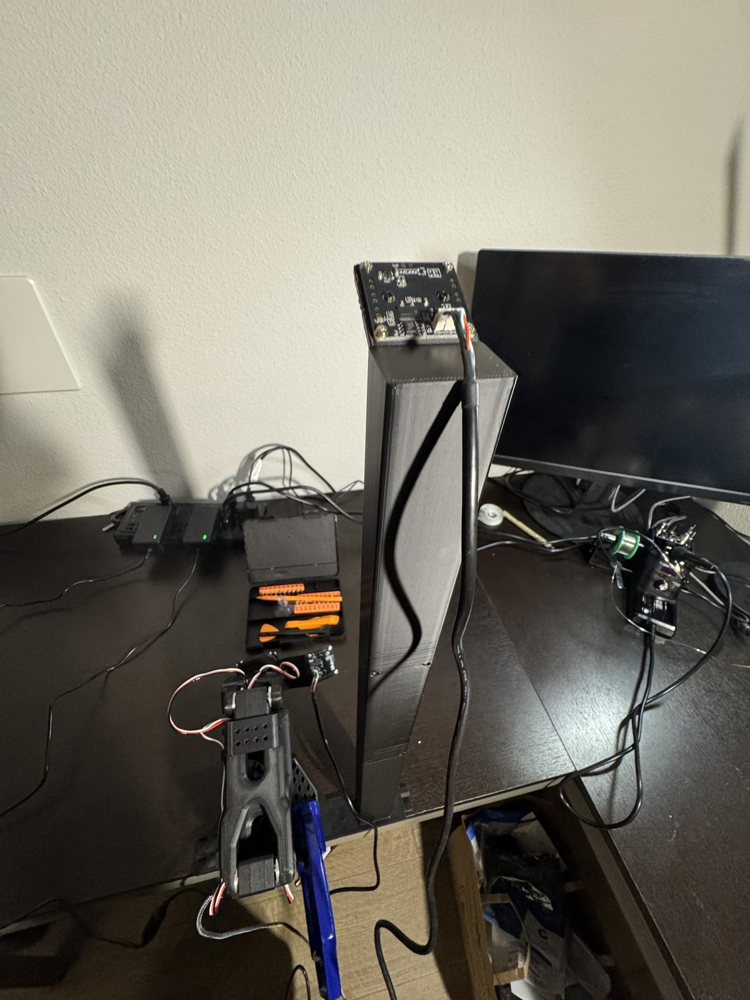</td>
  </tr>
</table>

<table>
  <tr>
    <th>First teleoperation</th>
    <th>Overhead camera</th>
    <th>Wrist camera</th>
  </tr>
  <tr>
    <td align="center">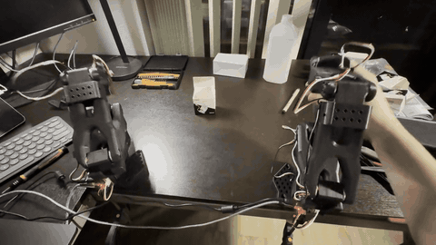</td>
    <td align="center">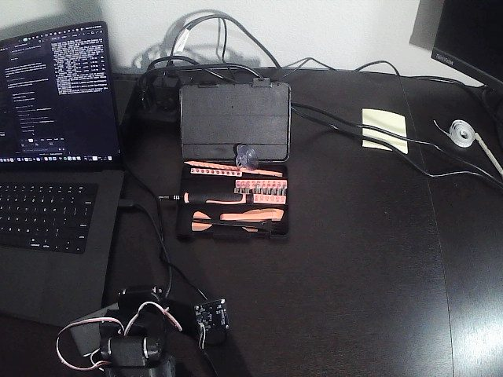</td>
    <td align="center">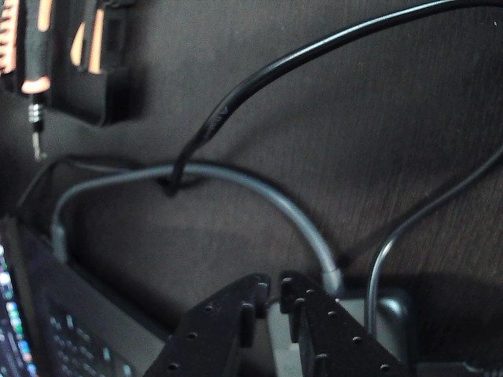</td>
  </tr>
</table>

| Part | Used |
| --- | --- |
| Arms | Two SO-101s in PLA+: leader (by hand) and follower |
| Motors | 12 Feetech STS3215 servos |
| Controllers | 2 Waveshare servo boards |
| Cameras | 2 small USB cameras: wrist and overhead |
| Software | LeRobot on a MacBook Pro (M3 Max), plus custom [recording, scoring and review tools](tools/) |

## How it learns

1. ***Show:*** steer the follower with the leader.
2. ***Record:*** both camera videos, joint angles, pass or fail.
3. ***Check:*** every episode against limits from the best demos; failures are left out.
4. ***Train:*** fine-tune π0.5 on the passes, in the cloud ([script](tools/train_cloud.sh)). Expensive, so it runs once the data is clean.
5. ***Run:*** the model drives the arm from the Mac.
6. ***Score:*** the same fixed layouts for every checkpoint, on the [eval page](tools/eval_ui.py); the [review tool](tools/review_trials.py) for every pick, drop and stall.
7. ***Repeat:*** more data where it fails, retrain, publish results, failures included.

Every command: [runbook](RUNBOOK.md).

## Credits

Arm design: [TheRobotStudio](https://github.com/TheRobotStudio/SO-ARM100). π0.5: [Physical Intelligence](https://github.com/Physical-Intelligence/openpi). Robot software: [Hugging Face LeRobot](https://github.com/huggingface/lerobot). Claude Code helped read the LeRobot source, write diagnostic scripts and keep notes. Build and hands-on testing by Jaxson Bie.
