<h1 align="center">SO-101 → π0.5: a robot arm that tidies tools</h1>

  Two robot arms built from scratch, then taught to put tools away with Physical Intelligence's π0.5. 
  <b>Built, wired, calibrated, debugged and tested by Jaxson Bie in six weeks.</b>

  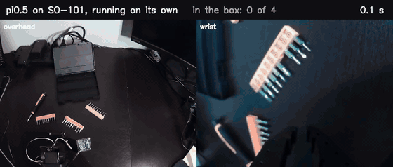 
  <b>The arm on its own: all four tools in the box in 41 seconds, no help.</b> Sped up 3×. <a href="https://github.com/Jaxsonb04/so101-pi05/raw/main/media/2026-11-10-first-pass.mp4">MP4 at real speed</a> · <a href="https://github.com/Jaxsonb04/so101-pi05/raw/main/media/2026-11-10-first-pass-raw.mp4">raw video</a> · <a href="media/2026-11-10-first-pass-joints.csv">joint data</a>

  <a href="REPORT.md"><b>Full project report</b></a> ·
  <a href="#highlights">Highlights</a> ·
  <a href="#problems-found-and-fixed">Problems fixed</a> ·
  <a href="#results">Results</a> ·
  <a href="#test-tools-built-for-the-job">Test tools</a> ·
  <a href="#the-build">Build</a> ·
  <a href="BUILD_LOG.md">Build log</a> ·
  <a href="RUNBOOK.md">Runbook</a>

## Highlights

- **Built two robot arms from parts.** Printed every piece, set up all 12 servos one at a time, wired both arms, and calibrated the pair to <ins>**under 0.5° apart**</ins>.
- **Brought up a full robot learning system.** Teleoperation at 60 Hz, two cameras, 153 recorded demonstrations, π0.5 fine-tuned on a cloud GPU, and the model driving the arm live from a MacBook.
- **The arm did the whole task on its own:** <ins>**all four tools into the toolbox**</ins>, then <ins>**3 full passes**</ins> on a 20-layout test after retraining.
- **Tracked down 36 problems** across mechanical, electrical, software and data, each traced to its root cause and written up in the [report](REPORT.md#7-fault-log).
- **Built the test tools the job needed:** a recording page, a scoring page, and a review tool that marks every pick, drop and pause on the video.
- **Tested it like a fleet robot:** the same 20 layouts and the same rules for every model, every trial recorded and reviewed.
- **Fixed a motor-safety bug in LeRobot:** motors switched on before they had a target. Reproduced it in tests first, then fixed it ([patch](patches/lerobot-so101-startup-shutdown.patch)).

## Problems found and fixed

The work that took the most care was finding out *why* something failed before changing anything. A few examples:

- **A camera that kept cutting out.** The obvious theory was USB bandwidth. The macOS system log showed the wrist camera physically disconnecting 193 times in one evening, and swapping hub sockets proved the fault followed the camera. <ins>**Isolated to the camera's cable**</ins> instead of rewriting code that wasn't broken.
- **21 failed trials that weren't the model's fault.** The recordings showed the two identical cameras had swapped places after a USB reconnect. The recording and scoring pages now <ins>**check which camera is which before the arm moves**</ins>.
- **A robot that jumped on startup.** Traced to LeRobot switching torque on before giving the motors a target. <ins>**Fixed and covered by tests.**</ins>
- **Arms 7° apart after calibration.** LeRobot's source showed a joint's zero is the middle of its calibration sweep. Matching the sweeps brought the arms to <ins>**under 0.5°**</ins>.
- **A model the robot couldn't load.** A test run that cost about a dollar showed the cloud software had changed versions that day. Pinning versions <ins>**caught it before paying for a full training run**</ins>.
- **27 recordings with mixed-up cameras.** A check on every episode found them, and they were <ins>**repaired without re-recording**</ins>.

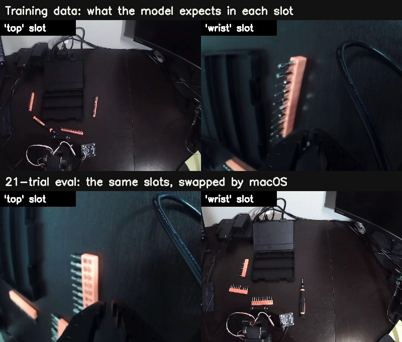

Top: what the model was trained on. Bottom: what it saw before the fix. The camera check now catches this automatically.

All 36, with how each was found: [report, fault log](REPORT.md#7-fault-log).

## Results

**First model, 50 demonstrations:** the first full pass, and 11 of 20 tools in the box over five trials with the best checkpoint.

**Finding what to fix next:** mapping every trial showed the model never solved the right side of the table, because only 8% of the demonstrations had tools there.

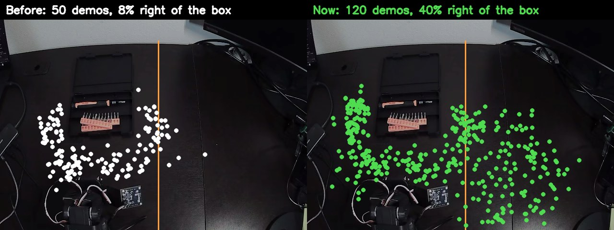

103 new demonstrations, every one checked: <b>8% → 40%</b> of tools right of the box.

**Retrained on 120 checked demonstrations:** the right side went from <ins>**no tools at all to the best zone**</ins>, and the model made <ins>**3 full passes**</ins> on 20 fixed layouts.

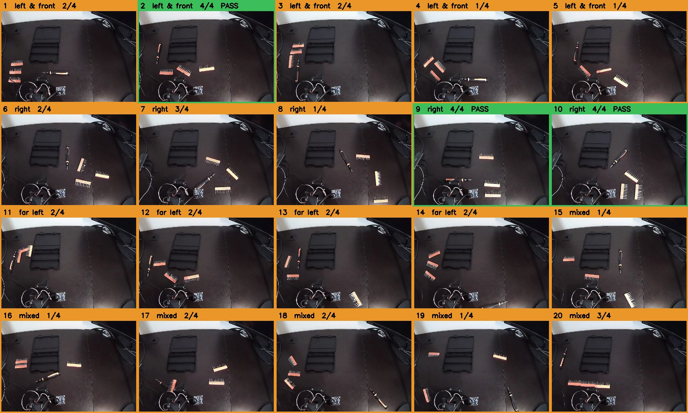

Every model gets the same 20 layouts in the same order. Each trial's first frame doubles as the layout photo.

| Zone | Tools in the box |
| --- | --- |
| **Right** (the first model's blind spot) | **14 / 20** |
| Left and front | 10 / 20 |
| Far left | 8 / 16 |
| Mixed and hard | 10 / 24 |

**Next step:** the reviews pinned down the one skill left to teach, finishing a grasp. The plan is correction data recorded right at those moments. More in the [report](REPORT.md#11-potential-next-steps).

### The full pass, raw

- ***[Raw video](https://github.com/Jaxsonb04/so101-pi05/raw/main/media/2026-11-10-first-pass-raw.mp4)***: both cameras exactly as the robot saw them, real speed, no edits.
- ***[Joint data (CSV)](media/2026-11-10-first-pass-joints.csv)***: all six joints, measured and commanded, 30 times a second.

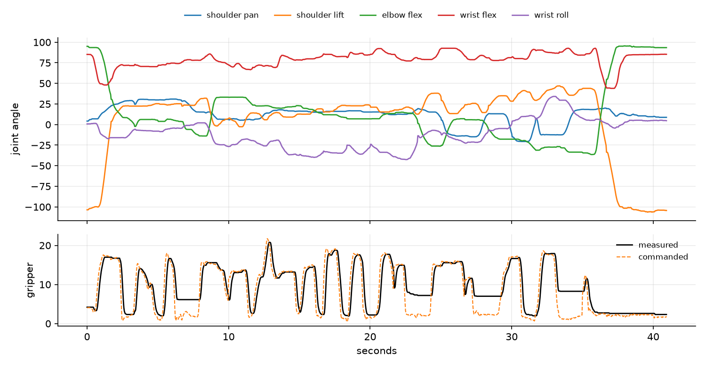

Bottom chart: where the black line stays above the orange one, the gripper is holding a tool. <b>Four holds, four tools.</b>

## Test tools built for the job

<table>
  <tr>
    <th width="50%">Scoring page</th>
    <th width="50%">Annotated review</th>
  </tr>
  <tr>
    <td align="center">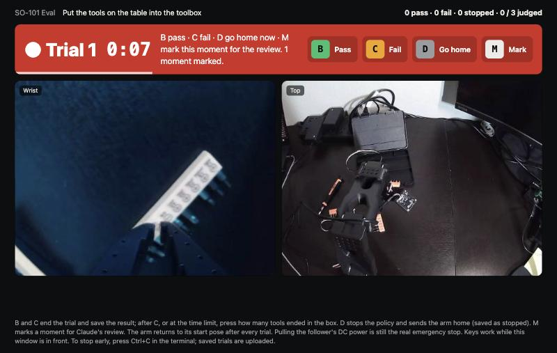</td>
    <td align="center">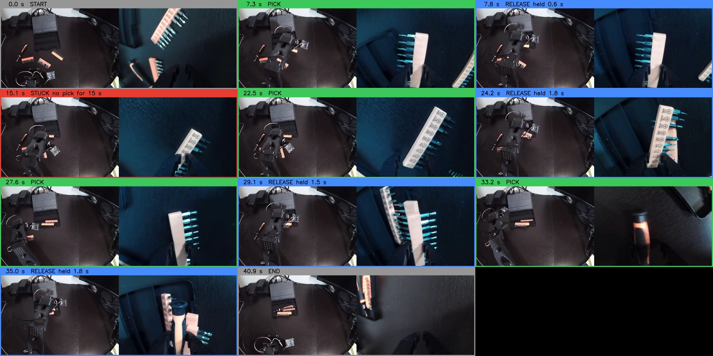</td>
  </tr>
  <tr>
    <td>One key each to start, pass, fail with a tool count, send the arm home, or mark a moment. The arm resets itself after every trial. <a href="tools/eval_ui.py">Code</a></td>
    <td>Every pick, release and pause marked on the frames, worked out from the gripper's readings. <a href="tools/review_trials.py">Code</a></td>
  </tr>
</table>

<table>
  <tr>
    <th width="24%">Teleoperating a demo</th>
    <th width="52%">The recording page</th>
    <th width="24%">First replay</th>
  </tr>
  <tr>
    <td align="center">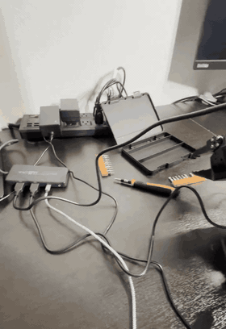</td>
    <td align="center">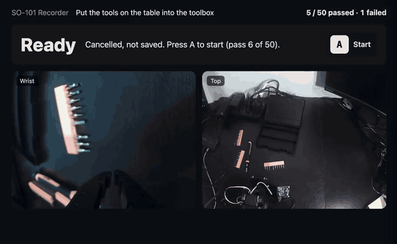</td>
    <td align="center">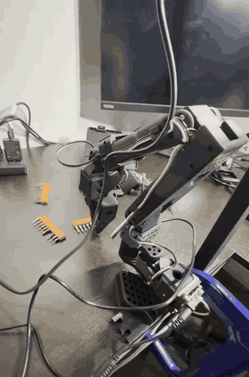</td>
  </tr>
  <tr>
    <td>The follower copies the leader. <a href="https://github.com/Jaxsonb04/so101-pi05/raw/main/media/2026-11-08-data-collection.mp4">MP4</a></td>
    <td>One key starts a take, others mark pass, fail or redo. Sped up 2×. <a href="https://github.com/Jaxsonb04/so101-pi05/raw/main/media/2026-11-08-recording-page.mp4">MP4</a></td>
    <td>The follower replaying a recorded take. <a href="https://github.com/Jaxsonb04/so101-pi05/raw/main/media/2026-11-08-first-replay.mp4">MP4</a></td>
  </tr>
</table>

### Every episode checked before training

Training runs on a rented cloud GPU, so every episode was checked first: every frame, the joint data, and a look at each one, against limits taken from the best demonstrations.

<table>
  <tr>
    <th width="50%">Every new episode against the limits</th>
    <th width="50%">Telling a thin grasp from a miss</th>
  </tr>
  <tr>
    <td align="center">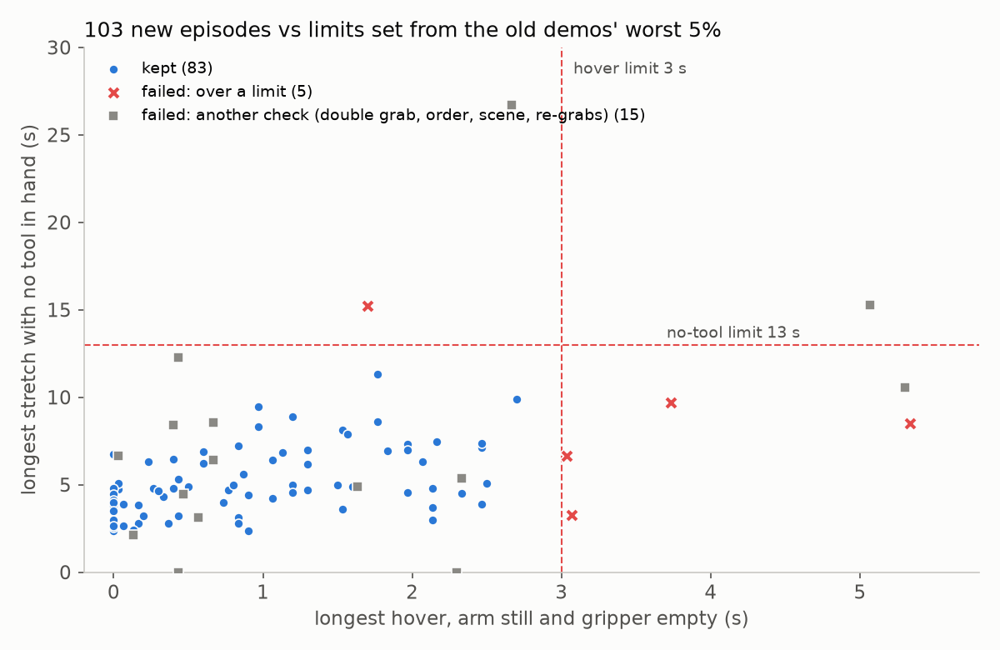</td>
    <td align="center">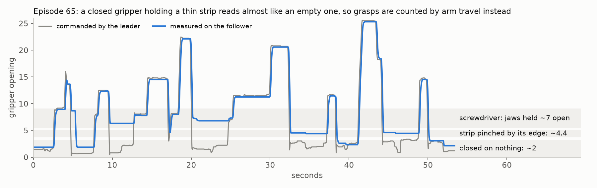</td>
  </tr>
  <tr>
    <td><b>83 of 103 kept.</b> The rest hovered, searched, grabbed two tools at once or broke the routine.</td>
    <td>A strip held by its edge reads almost like an empty gripper, so grasps are counted by <b>arm travel</b>, not jaw opening.</td>
  </tr>
</table>

## The build

<table>
  <tr>
    <th>Printing</th>
    <th>Motor bring-up</th>
    <th>Assembly</th>
    <th>Camera stand</th>
  </tr>
  <tr>
    <td align="center">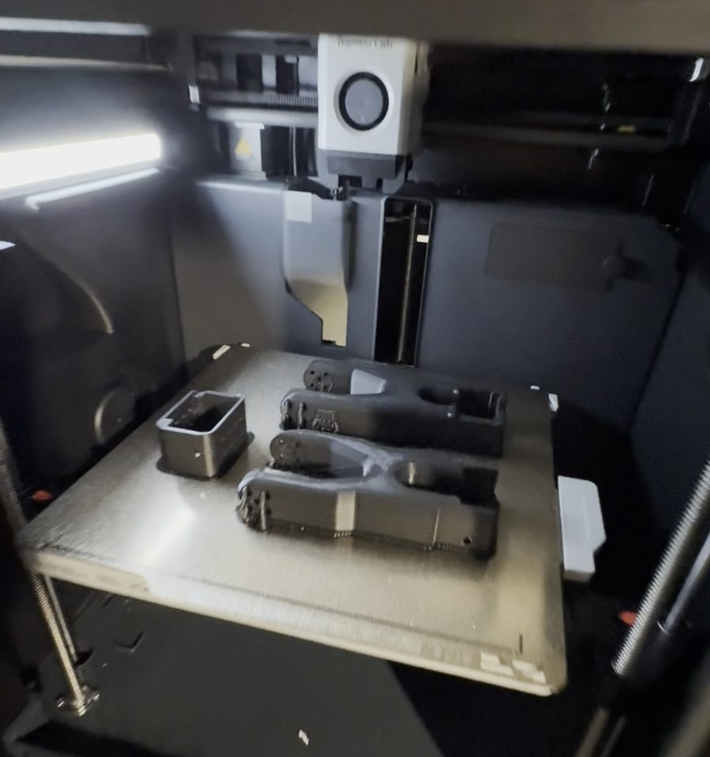</td>
    <td align="center">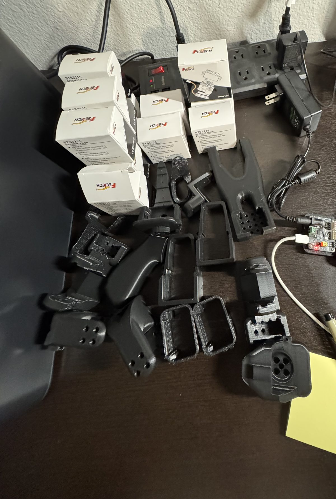</td>
    <td align="center">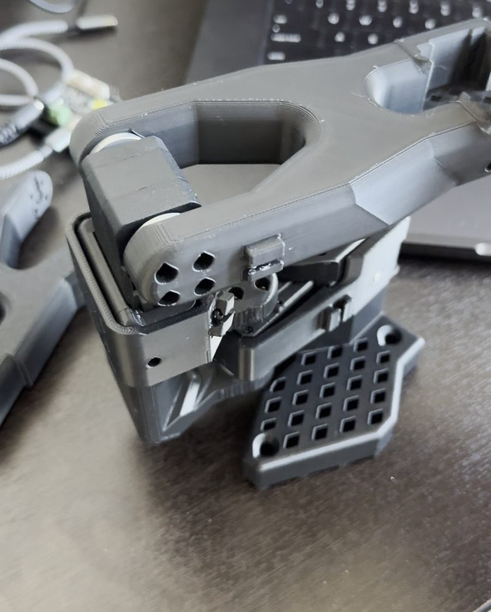</td>
    <td align="center">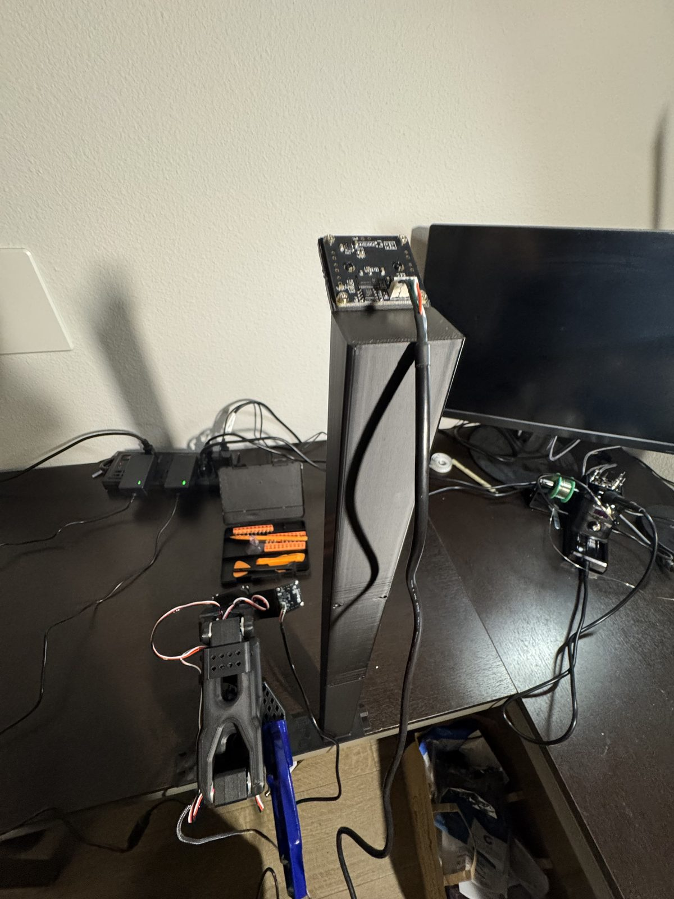</td>
  </tr>
</table>

<table>
  <tr>
    <th>First teleoperation</th>
    <th>Overhead camera</th>
    <th>Wrist camera</th>
  </tr>
  <tr>
    <td align="center">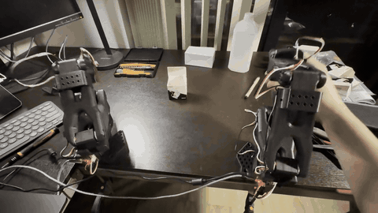</td>
    <td align="center">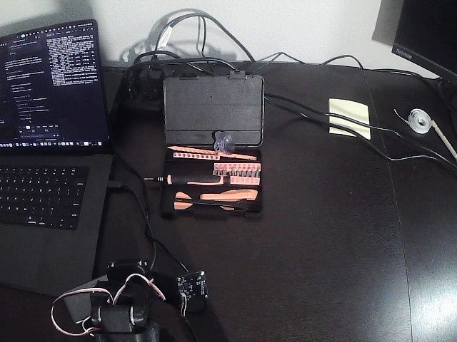</td>
    <td align="center">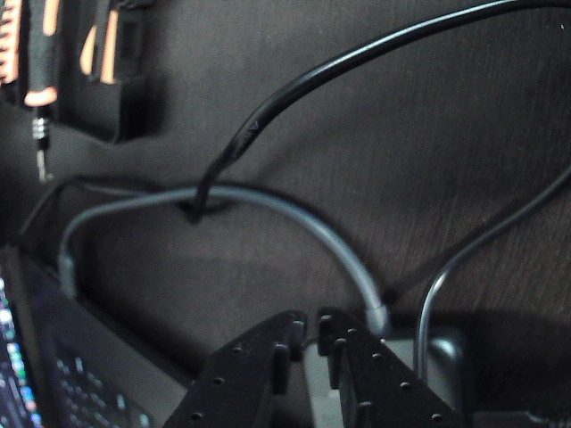</td>
  </tr>
</table>

| Part | Used |
| --- | --- |
| Arms | Two SO-101s in PLA+: a leader moved by hand and a follower that copies it |
| Printing | Bambu Lab P1S; small STL fit edits in Bambu Studio and Blender |
| Motors | 12 Feetech STS3215 servos in three gear ratios |
| Controllers | 2 Waveshare servo boards |
| Cameras | 2 USB cameras: wrist and overhead |
| Software | LeRobot on a MacBook Pro (M3 Max), plus custom [recording, scoring and review tools](tools/) |
| Redesigned parts | Controller mount holes and the leader's handle slot, refit for printed tolerances: [hardware/](hardware/) |

## How it learns

1. ***Show:*** steer the follower with the leader.
2. ***Record:*** both camera videos, joint angles, pass or fail.
3. ***Check:*** every episode against limits from the best demos.
4. ***Train:*** fine-tune π0.5 in the cloud ([script](tools/train_cloud.sh)).
5. ***Run:*** the model drives the arm from the Mac.
6. ***Score:*** the same fixed layouts for every model, on the [scoring page](tools/eval_ui.py).
7. ***Improve:*** add data where it struggles, retrain, score again.

Every command: [runbook](RUNBOOK.md).

## In this repo

| Path | What it is |
| --- | --- |
| [REPORT.md](REPORT.md) | Full project report |
| [BUILD_LOG.md](BUILD_LOG.md) | Day-by-day build log |
| [RUNBOOK.md](RUNBOOK.md) | Every command, in order |
| [tools/](tools/) | Recording page, scoring page, review tool, cloud training job |
| [patches/](patches/lerobot-so101-startup-shutdown.patch) | LeRobot startup and shutdown fix, with tests |
| [hardware/](hardware/) | The two redesigned printed parts and the script that made the handle change |
| [media/](media/) | Photos, videos, plots and raw joint data |

## Credits

Arm design: [TheRobotStudio](https://github.com/TheRobotStudio/SO-ARM100). π0.5: [Physical Intelligence](https://github.com/Physical-Intelligence/openpi). Robot software: [Hugging Face LeRobot](https://github.com/huggingface/lerobot). Claude Code helped read the LeRobot source, write diagnostic scripts and keep notes. Build and hands-on testing by Jaxson Bie.
