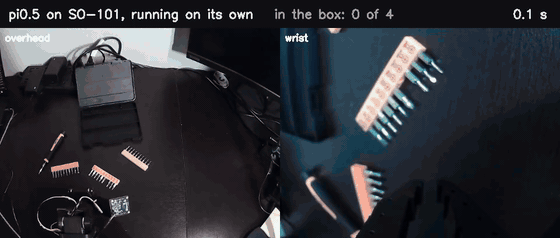
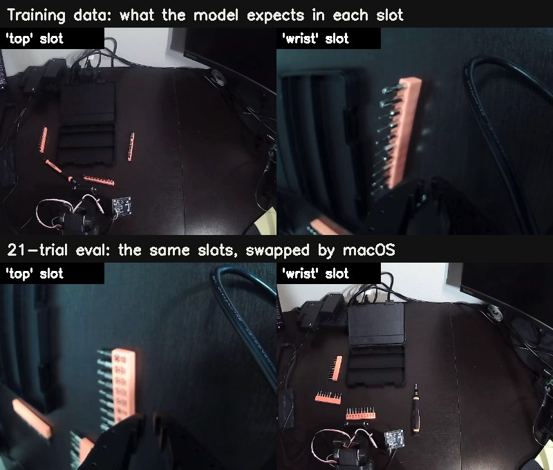
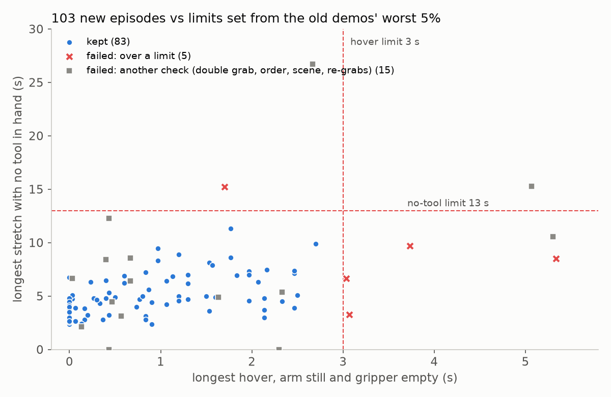
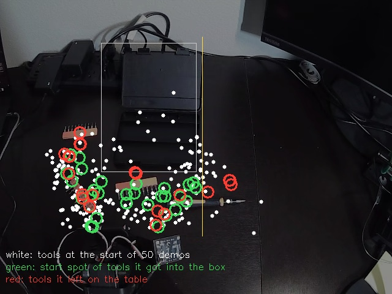
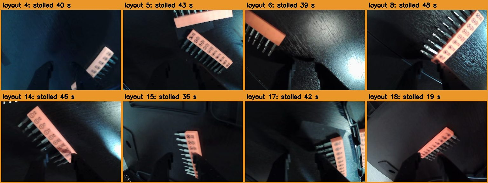

# SO-101 → π0.5: project report

**Jaxson Bie · October 3 – November 13, 2026 · paused November 15, 2026**

I built two SO-101 robot arms from scratch, wired and calibrated them, added two cameras, recorded 153 demonstrations, fine-tuned Physical Intelligence's π0.5 model on them, and tested the result on the real arm with a fixed protocol. This report covers the whole journey: what I built, every problem I hit and how I solved it, what I learned, and what I'd do next.

I did the building, wiring and testing myself. I used Claude Code, an AI coding assistant, to help me read the LeRobot source, write diagnostic scripts and keep notes.

**Contents:** [Summary](#1-summary) · [Why it matters for test and integration](#2-why-this-project-matters-for-a-robot-integration-and-test-technician) · [Five faults worth reading](#3-five-faults-worth-reading) · [Timeline](#4-timeline) · [The system](#5-the-system-under-test) · [How I tested](#6-how-i-tested) · [Fault log](#7-fault-log) · [Results](#8-results) · [What I learned](#9-what-i-learned) · [Open issues](#10-open-issues-at-the-pause) · [Future](#11-future-considerations) · [Files](#12-files)

---

## 1. Summary

| | |
| --- | --- |
| **Goal** | A robot arm that puts three bit strips and a screwdriver from the table into a toolbox, on its own |
| **Built** | Two SO-101 arms (a leader I move by hand, a follower that copies it), 12 servos, 2 controller boards, 2 USB cameras, printed camera mounts |
| **Data** | 50 demonstrations, then 103 more where the model failed; every episode checked; 120 kept for retraining |
| **Model** | π0.5, fully fine-tuned with Hugging Face LeRobot on a rented H200 GPU; runs on a MacBook Pro |
| **Best result** | A first full pass (4 of 4 tools) on November 10; the retrained model got 42 of 80 tools in the box and 3 of 20 passes on 20 fixed layouts |
| **Where it stands** | The model reaches every part of the table now, but it stalls when a grasp doesn't close on the tool. The fix is correction data at the moment of failure. One hardware fault (the wrist camera cable) is isolated but not yet replaced |

The first full pass, sped up 3×. <a href="https://github.com/Jaxsonb04/so101-pi05/raw/main/media/2026-11-10-first-pass-raw.mp4">Raw video</a> · <a href="media/2026-11-10-first-pass-joints.csv">joint data</a>

## 2. Why this project matters for a Robot Integration and Test Technician

Most of this project was integration and test work: getting hardware, firmware, software, cameras, a cloud training job and an ML model to work together, then finding out why they didn't. Here is how it lines up with what Physical Intelligence's Robot Integration and Test Technician role asks for.

| The role asks for | What I did on this project |
| --- | --- |
| **Quality control checks on new robots:** components installed correctly, hardware in the right configuration | Checked every printed part against the official parts list, with a checksum for each downloaded model file. Sorted the 12 servos by gear ratio from their box labels before assembly (the leader mixes three ratios). Scanned each arm's bus after assembly: one motor was missing, I reseated its cable, and all six answered on every scan after. After a week and a half away, I checked all 12 motors for faults and confirmed their stored calibration before moving anything. Read back the saved calibration file, which caught a joint I'd forgotten to sweep. |
| **Set up and provision hardware, software and firmware** following documentation | Wrote each servo's ID and baud rate one motor at a time, with a routine that refuses to write unless exactly one motor answers, then reads the new ID back. Calibrated both arms. Verified the LeRobot install (GPU, video decoding) before touching hardware. Set up camera permissions and mapping. Pinned the cloud training environment to the exact versions on the Mac. Wrote a [runbook](RUNBOOK.md) with every command, in order. |
| **Functional and performance tests** against acceptance criteria | Teleoperation at about 60 updates a second. Timed the model on the Mac before relying on it (0.64 s to plan 1.7 s of motion). Checked the trained model offline against my own recordings before it moved the arm. Scored checkpoints on [20 fixed layouts with fixed rules](#6-how-i-tested): hands off, 90 seconds, a pass only with all four tools in the box. Accepted demonstrations only inside limits taken from the best demos. Ran a 10-minute camera soak test and a 50-of-50 read test on two USB cables. |
| **Identify and document mechanical, electrical and software faults** | Logged more than 30 faults, each with its symptom, how I isolated it, the root cause and the fix: [fault log](#7-fault-log). Every failure is in the public [build log](BUILD_LOG.md), with photos, plots and raw data. |
| **Diagnostic tools and multimeters** | Multimeter on the motor power supply before first power-up. The macOS system log for USB disconnect events. Direct servo bus pings and register reads. Joint telemetry at 30 Hz, measured against commanded, plotted per trial. A live viewer for both cameras and the joints. Two tools of my own: an [eval page](tools/eval_ui.py) and a [review tool](tools/review_trials.py) that marks every pick, release and stall on the frames. I haven't used an oscilloscope or a PLC on this project. |
| **Problem solving, attention to detail, documentation, communication** | A trial that looked like a pass had started with the screwdriver already in the box; I caught it from the trial's first frame and recounted. 27 demos recorded with the cameras swapped were found by checking every episode, and repaired without re-recording. Daily notes, a public build log, a runbook, and every change reviewed before it was published. |

## 3. Five faults worth reading

These are the five that best show how I work: isolate before replacing, check the whole chain before blaming one part, and make the fix catch the problem next time.

### The wrist camera that kept dropping out (electrical, isolated)

**Symptom:** recordings stopped with "latest frame is too old": the wrist camera sent nothing for half a second.
**First guess, wrong:** both cameras share a USB hub, so I blamed bandwidth and tried a compressed video format. macOS ignores that setting, so it couldn't have been the fix.
**Isolation:** the macOS system log showed the wrist camera physically disconnecting and reconnecting about 30 ms later, at the exact moment each recording stopped: **193 times in one evening**, against once for the overhead camera on the same hub. That ruled out my code (it happened with nothing running) and bandwidth. Reseating the plug didn't help: a 10-minute soak test still dropped after 80 seconds. Then I swapped the two cameras between hub sockets, and **the drops followed the camera, not the socket**.
**Root cause:** the wrist camera's cable or plug, which flexes every time the arm moves.
**Decision:** no automatic reconnect, because it would hide the fault without saving the interrupted take. A drop ends the episode being recorded, and the recording page picks up where it left off. A new cable is the fix.

### 21 failed trials that weren't the model's fault (integration)

**Symptom:** the first proper evaluation was 21 trials, and every one failed.
**Isolation:** instead of retraining, I went through the recordings. The two camera feeds were in each other's slots: the model saw the overhead view where it expected the gripper's view.
**Root cause:** the two cameras are identical. After the wrist camera dropped off USB and came back, macOS gave them each other's numbers.
**Fix:** only the overhead camera can see the bright wall at the top of its picture, so the recording and eval pages compare the feeds and put them in the right slots before the arm moves. If the picture is too unclear to tell, they stop instead of guessing.
**It came back once:** after a crash, the limp arm left the wrist camera facing the wall, the check was fooled, and 27 demos were recorded swapped. I found them by running the wall test on every episode, repaired them by pointing those episodes at correctly placed copies of their videos, and moved the check to the start of every take, when the arm is in its start pose.

### The follower lurched on startup (firmware and software, motor safety)

**Symptom:** at startup the follower's wrist moved on its own, and at shutdown the elbow reported an overload.
**Isolation:** I read LeRobot's startup code. It switched motor torque on before writing a target position, so a servo could jump toward a stale or zero target. Shutdown stopped at the first motor that threw an error, leaving the others holding torque.
**Fix:** configure with torque off, read every joint's present position, write those as the targets, and only then enable torque. Shutdown now tries every motor and always closes the port, then reports all errors together. I wrote tests that reproduce both bugs first; 11 tests pass. The change is in [patches/](patches/lerobot-so101-startup-shutdown.patch) and applies cleanly to the LeRobot version this project pins.

### The arms didn't line up (calibration)

**Symptom:** even after recalibrating both arms, the follower's base sat a few degrees left of the leader's, and the wrist about 22° off.
**Isolation:** LeRobot's source showed that a joint's zero isn't the pose you hold at the start of calibration. It's the middle of the range you sweep through. I'd swung the two arms' bases different distances, so their middles were about 7° apart.
**Fix:** shifted the leader's saved range so the two middles match, kept a backup, and measured both arms in the same hand-held pose: **under 0.5° apart at the base, and within 0.1° at the wrist.**

### A model the robot couldn't load (software versions)

**Symptom:** a 20-step cloud test run failed with a config error. LeRobot's cloud image had been updated that same day.
**Isolation:** getting around that produced a test model, so I checked whether the Mac could load it before training for real. It couldn't: about half the weights had been renamed between versions.
**Fix:** the cloud job installs the exact LeRobot commit and `transformers` version I run locally before training. The next test model loaded on the Mac. Without the cheap test, I'd have found out after paying for a full run, with the arm waiting.

## 4. Timeline

| Dates | Phase | Outcome |
| --- | --- | --- |
| Oct 3–5 | First prints, software install | Controller mount hole fit found by test prints; LeRobot verified on the Mac's GPU |
| Oct 11–12 | Remaining 15 parts, servo setup | All parts printed on four plates; power supply measured; first motor IDs written |
| Oct 15 | Leader servo IDs | A USB error tested against both cables before blaming either |
| Oct 18–19 | Assembly, first teleoperation | Handle slot widened 1 mm in CAD; startup and shutdown bugs found and fixed with tests |
| Oct 30 | Back after a break | All 12 motors checked, calibration intact |
| Nov 4–8 | Camera mounts | Overhead stand and wrist mount printed; print orientation chosen from six options |
| Nov 6 | Can the Mac run π0.5? | 0.64 s to plan 1.7 s of motion |
| Nov 8 | Calibration, cameras, recording | Calibration offset solved; wrist camera dropout traced to hardware; recording page built; first 21 takes |
| Nov 9 | 50 demonstrations, first training | Every take reviewed; cloud versions pinned; π0.5 fine-tuned overnight |
| Nov 10 | First runs on the arm | Camera swap found; smooth mode replaced; eval and review tools; **first full pass**; coverage gap found |
| Nov 11 | More data, retraining | Camera cable isolated; 103 new demos; every episode checked; 120 kept; retrained |
| Nov 12–13 | Fixed-layout evaluation | Two checkpoints on 20 layouts: a tie at 42 of 80; every trial reviewed |
| Nov 14–15 | Wrap-up | Kept the 11,000-step checkpoint, skipped scoring a third; project paused |

## 5. The system under test

### Hardware

| Part | Details |
| --- | --- |
| Arms | Two [SO-101](https://github.com/TheRobotStudio/SO-ARM100)s printed in PLA+ on a Bambu P1S |
| Follower servos | 6 × Feetech STS3215, 1:345 gearing (C001) |
| Leader servos | Shoulder pan and elbow 1:191 (C044), shoulder lift 1:345 (C001), wrist flex, wrist roll and gripper 1:147 (C046), so it's easy to move by hand |
| Controllers | 2 × Waveshare bus servo adapters, servo bus at 1 Mbps, IDs 1–6 on each arm |
| Power | 5 V 4 A supplies; the one I measured read 5.5 V unloaded. The board doesn't regulate, so the motors see exactly that |
| Cameras | 2 × InnoMaker 32 mm USB camera boards, 640×480 at 30 fps: one on the wrist, one on a printed overhead stand |
| Compute | MacBook Pro (M3 Max) runs the arm and the model; training on a rented H200 through Hugging Face Jobs |

### Changes I made to the hardware

| Part | Change | Why |
| --- | --- | --- |
| Controller mount | Holes +0.2 mm ([STL](hardware/WaveShare_Mounting_Plate_SO101_Holes_Plus_0p2mm.stl)) | The board's brass spacers didn't fit. +0.6 mm was too loose; +0.2 mm was snug |
| Leader handle | Slot +1 mm, 0.5 mm per side ([STL](hardware/Handle_SO101_Slot_Plus_1mm_Upright.stl), [script](hardware/make_handle_revision.py), [check](hardware/geometry-check.json)) | The handle didn't fit its mount. The script only removes material at the slot and checks the part stays watertight and the same outside size |
| Print orientation | Handle printed standing; wrist mount picked from six orientations | Keeps support marks off the surfaces you hold and the faces that mate |

### Software

- [Hugging Face LeRobot](https://github.com/huggingface/lerobot), pinned to commit `8c920c4` with `transformers==5.5.4`, on the Mac and in the cloud.
- [π0.5](https://www.physicalintelligence.company/blog/pi05), fully fine-tuned from `lerobot/pi05_base`, with image augmentation because the recordings came from sessions with different lighting.
- My own tools in [tools/](tools/): a [recording page](tools/record_ui.py), an [eval page](tools/eval_ui.py), a [review tool](tools/review_trials.py), and the [cloud training job](tools/train_cloud.sh).
- A local fix to LeRobot's startup and shutdown ([patch](patches/lerobot-so101-startup-shutdown.patch)).

## 6. How I tested

### Bring-up checks, before anything moved

| Check | Result |
| --- | --- |
| Supply voltage with a multimeter, before connecting motors | 5.5 V unloaded |
| One motor at a time: exactly one answers, write the ID, read it back | 12 of 12 set |
| Bus scan after assembly | 6 of 6 on each arm, every scan, after reseating one cable |
| Two USB cables, 50 repeated reads each | 50 of 50 on both |
| Teleoperation with the official command, no changes | Smooth at about 60 Hz |
| Leader and follower in the same hand-held pose | Under 0.5° apart after the calibration fix |
| Model timing on the Mac, random weights | 0.64 s to plan 1.7 s of motion |
| Trained model fed my own recordings offline, before running on the arm | About 2° off what I did; holding still would be about 16° off. So the cameras, the joint order and the task text all reached the model correctly |

### Acceptance criteria for demonstrations

Training costs about $37 a run, so every episode was checked first. Each limit comes from the first 50 demos' worst 5%:

- No hover of 3 s or more, no more than 13 s with no tool in hand, no more than 2 grabs at nothing.
- The right scene and toolbox spot, the screwdriver first, one tool at a time, all four tools in the box.
- No camera freezes, joint glitches or dropped frames.

83 of 103 new episodes passed. Two old ones failed too, both double grabs.

### Evaluation protocol

- **The same 20 layouts, in the same order, for every checkpoint:** 5 left and front, 5 right, 4 far left, 6 mixed or hard.
- **The same rules:** hands off, 90 seconds, a pass only when all four tools are in the box; otherwise count the tools that made it.
- **Before every trial:** toolbox empty, four tools on the table, box on its tape.
- **Every trial recorded.** Its first overhead frame is the layout picture, which is how I set up the next checkpoint and how I audited the runs afterwards.
- **Every trial reviewed:** the [review tool](tools/review_trials.py) marks every pick, release and stall from the gripper readings; then I looked at both cameras at each mark.

## 7. Fault log

Every fault I hit, grouped by type. "Isolation" is how I found the cause.

### Mechanical and printing

| Symptom | Isolation | Root cause | Fix |
| --- | --- | --- | --- |
| Brass spacers wouldn't go into the controller mount | Test prints at +0.6 mm and +0.2 mm | Printed holes come out tighter than the model | +0.2 mm holes: snug |
| Leader handle wouldn't fit its mount | Fit check | Slot too tight for printed tolerances | Slot widened 1 mm by a script that checks the result; reprinted |
| Overhead stand plate failed | Inspected the plate | First layer didn't stick | Reprinted; came out fine |
| Support marks would land on the handle's grip | Compared orientations in the slicer | Printing on its side puts supports on the grip | Printed standing |
| Arm pushed the toolbox in at least 2 trials per checkpoint | Review frames | The box is held only by tape | Open: a fixture that bolts the box down |

### Electrical and connectivity

| Symptom | Isolation | Root cause | Fix |
| --- | --- | --- | --- |
| "Motor not found" during ID setup | Checked what was connected | Only USB was plugged in; USB powers the board, not the motors | Connect the motor power supply |
| "Device not configured" during leader setup | Both cables, 50 reads each, same setup | Not the cable: both passed 50 of 50 | Didn't recur; kept the cable |
| One follower motor missing from the scan | Reseated its cable | Loose connector | 6 of 6 on every scan after |
| Gripper communication error on the first start after a break | Re-ran the same command | Intermittent; cleared on retry | Logged in the runbook's troubleshooting table |
| Wrist camera dropped out | System log, soak test, swapped hub sockets | The camera's cable or plug | Open: new cable. A drop ends that episode; the page resumes |
| No cameras found | Checked macOS privacy settings | Terminal had no camera permission | Granted it |

### Firmware, software and integration

| Symptom | Isolation | Root cause | Fix |
| --- | --- | --- | --- |
| Wrist moved on its own at startup | Read the startup code; reproduced in a test | Torque enabled before a target was set | Seed targets from present positions, then enable torque ([patch](patches/lerobot-so101-startup-shutdown.patch)) |
| Some motors kept torque after an error at shutdown | Reproduced in a test | Shutdown stopped at the first error | Release every motor, always close the port |
| Follower slow and laggy | Compared with the official command | A speed limit I'd added | Removed it; back to the standard setup |
| Follower base 7° and wrist 22° off the leader | Read the calibration code; measured | Zero is the middle of the swept range; uneven sweeps | Matched the ranges: under 0.5° |
| Gripper not calibrated | Read back the saved file | Forgot to sweep it | Redid that arm's calibration |
| Camera views labelled backwards | Looked at saved frames | Cameras numbered in the wrong order | Fixed before any recording |
| 21 eval trials failed | Watched the recordings | Cameras renumbered after a USB drop | Automatic check before the arm moves |
| 27 demos recorded swapped | Wall test on every episode | A limp arm after a crash fooled the check | Repaired the episodes; recheck at every take |
| Cloud training config error | Compared versions | Cloud image updated that day | Pinned versions in the job |
| Test model wouldn't load on the Mac | Loaded it before the real run | Weights renamed between versions | Same pin |
| Arm swung between two tools | Read the real-time chunking code | It replanned every ~0.7 s and kept little of the old plan | Plain mode, which commits to each 1.7 s plan: 0 → 5 of 20 tools |
| LeRobot's scoring mode dropped both arms | Saw it, then confirmed in LeRobot's code | It drove the leader to the follower, then let go | My own eval page, run without the leader |
| Lost a 1-minute take with Ctrl+C | Retraced the steps | Stopping during the reset pause discards the take | My own recording page with explicit keys |
| An old process blocked the next run | The next run couldn't start | Interrupted during model loading, it kept running | The pages now say so |
| Cleanup timer outlived the training job | Ran the job script locally with stand-ins | The loop wasn't stopped at the end | Stopped explicitly |
| Cloud cleanup deleted nothing | Re-read the script after launch | A `sed '$d'` inside a single-quoted command reached the cloud without its quotes | Fixed in [tools/](tools/train_cloud.sh); harmless on that run |

### Data and evaluation

| Symptom | Isolation | Root cause | Fix |
| --- | --- | --- | --- |
| Good takes looked unfinished | Decoded frame by frame | Fast seeking lands seconds late in these videos | Frame-by-frame decoding |
| My hand, my laptop screen and orange scraps in view | Frames from 8 test takes | Untidy scene | Cleaned up; only the tools move between takes |
| Right side of the table never solved | Mapped demo tool spots against results | Only 8% of demo tool spots were on the right | 103 new demos: 8% → 40% |
| More training did worse (11 → 6 of 20 tools) | Halfway against final checkpoint | Likely overfitting 50 demos | Save more checkpoints and pick on the arm |
| Six good demos counted as misses | Plotted gripper opening | A strip pinched by its edge reads almost like an empty gripper | Count grasps by arm travel instead |
| Training set lost the left side | Coverage check after selection | Filtered by tool order | Cancelled after 5 minutes; reselected |
| Eval count reset after a crash | Compared saved trials | Each run started counting at zero | `--continue` counts saved trials |
| A pass that wasn't | First frame of the trial | The screwdriver was left in the box | Recounted; table check before every trial |
| A trial's recording missing | Compared first frames with layouts | Its label was saved, its video wasn't | Redid that layout |

## 8. Results

### First model: 50 demos

| Setup | Tools in the box |
| --- | --- |
| Smooth (real-time) mode, cameras correct | 0 |
| Plain mode, first 5 trials | 5 of 20 |
| Final checkpoint (7,000 steps), 5 trials | 6 of 20 |
| **Halfway checkpoint (3,500 steps), 5 trials** | **11 of 20, one full pass** |

White: where tools sat in the demos. Green: put in the box. Red: left behind. Nothing on the right went in.

### Retrained model: 120 demos, 20 fixed layouts

| Zone | Layouts | 11,000 steps | 10,000 steps |
| --- | --- | --- | --- |
| Left and front | 1–5 | 10 / 20 | 8 / 20 |
| **Right** (the first model's blind spot) | 6–10 | **14 / 20** | **12 / 20** |
| Far left | 11–14 | 8 / 16 | 7 / 16 |
| Mixed and hard | 15–20 | 10 / 24 | 15 / 24 |
| **Total** | | **42 / 80, 3 passes** | **42 / 80, 2 passes** (fair count) |

Every failed trial contains a stall like this: a tool at the jaws, the gripper closing on air, 40 seconds typical.

**What the numbers say:**

1. **More data fixed what it targeted.** The right side went from no tools to the best zone.
2. **It didn't raise the overall score.** The bottleneck is one skill: finishing a grasp, on the strips and in 5 trials the screwdriver too. When the first grasp fails, the arm rarely moves on to another tool.
3. **The two checkpoints tie.** Only 6 of the 19 fair layouts got the same score from both. With one trial per layout, a gap of a few tools in 80 can't rank two models.

## 9. What I learned

1. **Start from the documented setup and change one thing at a time.** My "safety" speed limit made the follower lag. The official command just worked.
2. **Test a suspect before replacing it.** The USB cable I blamed passed 50 of 50 reads. Swapping hub sockets proved the camera fault followed the device.
3. **System logs beat guesses.** I had a plausible bandwidth theory. The log showed 193 physical disconnects on one camera.
4. **Check the whole chain before blaming the expensive part.** 21 failed trials looked like a bad model and were swapped cameras.
5. **Don't hide a fault with an automatic retry.** A silent reconnect would have kept the camera "working" while losing data.
6. **Run the cheap test before the expensive one.** A 20-step job, a local run with stand-ins and a byte-for-byte data check each caught a problem before a $37 run.
7. **Test the tester.** My video review seeked to the wrong frames, and my grasp counter failed good demos. Both looked like data problems at first.
8. **Fix the protocol, then compare.** Fixed layouts and rules made results comparable, and showed that one trial per layout is still too noisy.
9. **Check the setup before every trial.** One leftover screwdriver turned a fail into a pass. A 10-second table check prevents it.
10. **Where the data is matters more than how much there is.** 8% coverage on the right meant zero success on the right.
11. **Write it down as you go.** The notes are how I found the swapped episodes, the false pass and the missing recording.

## 10. Open issues at the pause

| Issue | State |
| --- | --- |
| Wrist camera cable | Isolated to the camera's cable or plug; replacement not done |
| Grasp stall | Every failed trial contains one; needs correction data |
| Toolbox pushed by the arm | At least 2 trials per checkpoint; the box is only taped |
| Two crashes during the November 12 eval | Cause not captured |
| One trial per layout | Too noisy to rank checkpoints |
| LeRobot startup and shutdown fix | Local patch with tests; not offered upstream yet |

## 11. Future considerations

### Hardware and test

- Replace the wrist camera cable and route it with strain relief at the wrist; then repeat the 10-minute soak test as the pass criterion.
- Log USB disconnects automatically during every session, so dropouts show up as data instead of surprises.
- Put an oscilloscope on the servo bus to see the communication errors directly, and measure supply voltage under load and servo temperature over a long session.
- Bolt the toolbox to a fixture so the arm can't move it mid-trial.
- Turn the bring-up checks above into a one-page acceptance sheet for a new arm: power, IDs, bus scan, calibration match, cameras, teleoperation.

### Software

- Offer the startup and shutdown fix to LeRobot as a pull request, with its tests.
- Capture full logs on every crash.
- An automatic preflight before each trial: all motors answer, cameras in the right slots, the arm at its start pose.

### Model and data

- Record corrections where the arm stalls (LeRobot's takeover mode): strips at the box's left edge and near the base, and the screwdriver near the base, beside the box and at the far edges.
- Add demos that back off after a missed grasp and try another tool.
- Retrain, then test on fewer layouts with repeats (for example 5 layouts × 4 trials) so a result can be trusted.

## 12. Files

| Path | What it is |
| --- | --- |
| [README.md](README.md) | The project at a glance |
| [REPORT.md](REPORT.md) | This report |
| [BUILD_LOG.md](BUILD_LOG.md) | Day-by-day build log, mistakes included |
| [RUNBOOK.md](RUNBOOK.md) | Every command, in order, from access to evaluation |
| [tools/](tools/) | Recording page, eval page, review tool, cloud training job, practice script |
| [patches/](patches/lerobot-so101-startup-shutdown.patch) | LeRobot startup and shutdown fix with tests, for commit `8c920c4` |
| [hardware/](hardware/) | The two revised printed parts and the handle revision script |
| [media/](media/) | Photos, videos, plots and raw joint data |
| [so101.env.example](so101.env.example) | Settings template for ports, cameras and names |

Not published: my private working notes, the full LeRobot checkout, the print project files, and the model checkpoints and dataset, which stay private on Hugging Face.

## Credits

Arm design: [TheRobotStudio](https://github.com/TheRobotStudio/SO-ARM100). π0.5: [Physical Intelligence](https://github.com/Physical-Intelligence/openpi). Robot software: [Hugging Face LeRobot](https://github.com/huggingface/lerobot). Claude Code helped read the LeRobot source, write diagnostic scripts and keep notes. Build and hands-on testing by Jaxson Bie.
