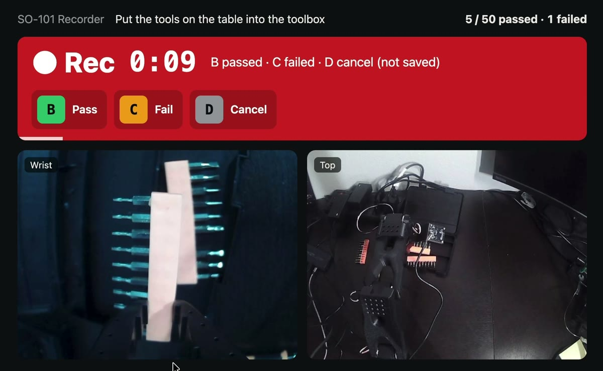

# Runbook: SO-101 + π0.5

Work from top to bottom. The flags were checked against LeRobot 0.6.2. Steps 1–4 (access, hardware, cameras, recording and replay), steps 6–7 (running and scoring the model) and step 8's extra demos have been run on the arm, and step 5 has been run in the cloud. Step 8's correction mode hasn't been run yet.

## Before you start

Do this once:

```bash
cp so101.env.example so101.env
```

Then fill in the first five values in `so101.env`.

Do this in every new terminal, from this folder:

```bash
source ~/miniforge3/bin/activate lerobot
```

```bash
source so101.env
```

## 1. Get access

No hardware is needed for this step.

1. Create a token with **Write** access at [huggingface.co/settings/tokens](https://huggingface.co/settings/tokens).
2. Accept the license at [google/paligemma-3b-pt-224](https://huggingface.co/google/paligemma-3b-pt-224). π0.5 can't load its tokenizer without this.
3. Add credit at [huggingface.co/settings/billing](https://huggingface.co/settings/billing). Jobs need a positive balance. About $25 covers a smoke test and one full training run.
4. Log in:

```bash
hf auth login
```

5. Put your username in `so101.env` as `HF_USER`, then source the file again. This prints your username:

```bash
hf auth whoami
```

## 2. Finish the hardware

1. Check that the camera board's holes are about 27 mm apart. Both mounts are designed for that.
2. Print the [overhead stand](https://github.com/TheRobotStudio/SO-ARM100/tree/a758567c3978dfeefe282ede0500085a48fe8f78/Optional/Overhead_Cam_Mount_32x32_UVC_Module) and the [wrist mount](https://github.com/TheRobotStudio/SO-ARM100/tree/a758567c3978dfeefe282ede0500085a48fe8f78/Optional/Wrist_Cam_Mount_32x32_UVC_Module). Together they take about 8.5 hours and 260 g of filament, so check the spool first.
3. Test-fit each stand joint by hand, then assemble it with M2 screws.
4. With power off, swap the wrist mount in for `Wrist_Roll_Follower_SO101`. Note how the old part sits on the horn first, and keep it.
5. Recalibrate the follower, then the leader. At the existing-file prompt, type `c` and press Enter, because plain Enter reuses the old calibration. Use the same reference pose on both arms. LeRobot puts each joint's zero at the middle of the range you sweep, not at the reference pose, so sweep every joint fully and evenly both ways. If a joint still sits off afterwards, measure both arms in the same pose and shift the leader's range, as described in the [build log](BUILD_LOG.md#november-8-calibration-root-cause-and-cameras).

```bash
lerobot-calibrate --robot.type=so101_follower --robot.port=$FOLLOWER_PORT --robot.id=follower
```

```bash
lerobot-calibrate --teleop.type=so101_leader --teleop.port=$LEADER_PORT --teleop.id=leader
```

6. Mount the follower on the stand and fit both cameras.

Calibrate after the wrist swap, so you only do it once.

## 3. Check the cameras

```bash
lerobot-find-cameras opencv
```

This saves a test image from each camera. Use the images to set `WRIST_CAM` and `TOP_CAM` in `so101.env`, then source it again. The Mac's own camera also gets an index. Indexes can change after a replug, so recheck them each session.

Now teleoperate with both feeds on screen:

```bash
lerobot-teleoperate --robot.type=so101_follower --robot.port=$FOLLOWER_PORT --robot.id=follower --robot.cameras="$CAMERAS" --teleop.type=so101_leader --teleop.port=$LEADER_PORT --teleop.id=leader --display_data=true
```

Check that you could do the task yourself using only those two views. Support the follower before Ctrl+C, because stopping releases its holding torque.

## 4. Record demonstrations

I record with a small page I built, [`tools/record_ui.py`](tools/record_ui.py). It runs LeRobot's own `lerobot-record` with the usual flags (no LeRobot files changed) and replaces the keyboard controls with a browser page that shows both cameras:

| Key | What it does |
| --- | --- |
| `A` | Start recording an episode. Between episodes the follower still copies the leader, but nothing is recorded |
| `B` | Pass: save the episode, labelled passed |
| `C` | Fail: save the episode, labelled failed. Failed attempts are data too |
| `D` | Cancel: throw the episode away (false starts, bumps) and record it again |



- `--dataset.num_episodes` is the number of **passed** episodes wanted in the dataset. Failed and cancelled ones don't count.
- Every result goes into `episode_labels.csv` inside the dataset, which is uploaded with it.
- Ctrl+C keeps every saved episode and uploads them. Running the same command again continues the same dataset, and earlier passes count toward the target.
- At the end it prints the flag that skips the failed episodes in training, e.g. `--dataset.exclude_episodes="[2, 12]"`.
- The page checks which camera is which (only the overhead one sees the wall) at start and again every time you press **A**, with the arm in its start pose. A check only at start can be fooled: after a crash left the arm limp, the wrist camera faced the wall and 27 episodes were recorded with the views swapped.
- `--dataset.no_stamp=true` keeps the dataset name exactly as given. Without it LeRobot adds a date-time stamp, and the replay and train commands below wouldn't find the data.

Try the page without the robot: `python tools/record_ui.py --demo`. Practise with the real arm and cameras, without touching your datasets or uploading anything: `tools/practice.sh`.

Start with 5 test passes:

```bash
python tools/record_ui.py --robot.type=so101_follower --robot.port=$FOLLOWER_PORT --robot.id=follower --robot.cameras="$CAMERAS" --teleop.type=so101_leader --teleop.port=$LEADER_PORT --teleop.id=leader --dataset.repo_id=${DATASET}_test --dataset.num_episodes=5 --dataset.single_task="$TASK" --dataset.episode_time_s=120 --dataset.private=true --dataset.no_stamp=true --dataset.streaming_encoding=true --dataset.encoder_threads=2
```

Replay a passed episode to check the recording. The follower repeats the recorded joint motions by itself, so clear the table first:

```bash
lerobot-replay --robot.type=so101_follower --robot.port=$FOLLOWER_PORT --robot.id=follower --dataset.repo_id=${DATASET}_test --dataset.episode=1
```

Then run the same record command with `--dataset.repo_id=$DATASET` and `--dataset.num_episodes=50`.

- Don't move the cameras or the toolbox between episodes. Tape two corners of the toolbox.
- Change only where the 3 tools sit, and at what angle, every episode. Spread them over the whole reachable table.
- Keep hands, screens and anything that looks like the tools out of the overhead view. A laptop screen in view changes between episodes, which a policy can latch onto.
- Leave `--dataset.private=true` on, because the overhead camera can see your room.

If you use plain `lerobot-record` instead, add `--dataset.no_stamp=true`, and don't press Ctrl+C during its "Reset the environment" pause: it saves an episode only after that pause.

## 5. Fine-tune π0.5

This can't run on the Mac. It runs on a cloud H200 through Hugging Face Jobs at $5 an hour, and the timeout caps the spend. In my smoke tests the H200 took 2.28 s per step against the A100's 5.17 s, at twice the price, so it was slightly cheaper per step (the two runs used different software versions, so treat that as rough).

**Don't use `lerobot-train --job.target=...` from LeRobot 0.6.2.** It uploads your settings as a config file and trains in `huggingface/lerobot-gpu:latest`, which follows upstream LeRobot. On November 9 that image had moved to 0.7.1: the first job rejected the config, and a model trained on the newer image wouldn't load on the Mac (437 of 813 weight names differed). The command below starts the same image, installs the Mac's exact LeRobot commit and `transformers` version into it, prints the versions, then runs `lerobot-train` with your flags. Check your versions with `git -C lerobot rev-parse HEAD` and `pip show transformers`, and change both in the command if yours differ.

Keep the `--dataset.exclude_episodes` flag the recording page printed (mine was `[2,12]`), so training uses passed episodes only.

### Smoke test

Run the full-run command below with four changes: `--timeout 30m`, `--policy.repo_id=${POLICY}_smoke`, `--steps=20` and `--save_freq=20`. It costs under $1. It proves the image, your dataset and checkpoint upload all work before you pay for the long run.

Then check that the smoke model's config loads on the Mac. An error here means the cloud trained with a different LeRobot version. A clean load doesn't rule out a `transformers` mismatch, which renames weights instead, so keep both versions pinned:

```bash
python -c "from lerobot.configs.policies import PreTrainedConfig; print(PreTrainedConfig.from_pretrained('${POLICY}_smoke').type)"
```

Read the seconds per step from the log (`hf jobs logs <job-id>`), then multiply by the full run's steps. If that's over 6 hours, raise `--timeout` below. Then delete the smoke model, which can't be undone:

```bash
hf repos delete ${POLICY}_smoke
```

### Full run

7,000 steps at batch 32 is about 5 passes over my 50 demonstrations. This is a full fine-tune: the 141 GB H200 doesn't need the memory saving of training only the action expert, which LeRobot's docs say comes at some cost in success rate. Image augmentation is on, as in openpi's own training recipe. It saves a checkpoint at the halfway point and at the end, so you can compare them on the arm.

It ran at 2.28 s per step, so about 4.5 hours and about $23. `--timeout 6h` caps it at $30.

```bash
hf jobs run --flavor h200 --timeout 6h --secrets HF_TOKEN --detach \
  huggingface/lerobot-gpu:latest \
  bash -c 'uv pip install --python /lerobot/.venv/bin/python "lerobot[pi] @ git+https://github.com/huggingface/lerobot@8c920c4270460851cedd2737657584586d3dc66f" "transformers==5.5.4" && python -c "import lerobot, transformers, torch; print(lerobot.__version__, transformers.__version__, torch.__version__)" && lerobot-train "$@"' _ \
  --dataset.repo_id=$DATASET \
  --dataset.exclude_episodes="[2,12]" \
  --dataset.image_transforms.enable=true \
  --num_workers=8 \
  --policy.type=pi05 \
  --policy.pretrained_path=lerobot/pi05_base \
  --policy.repo_id=$POLICY \
  --policy.private=true \
  --policy.empty_cameras=1 \
  --policy.gradient_checkpointing=true \
  --policy.dtype=bfloat16 \
  --batch_size=32 \
  --steps=7000 \
  --save_freq=3500 \
  --save_checkpoint_to_hub=true \
  --output_dir=outputs/pi05_so101_tools_toolbox \
  --job_name=pi05_so101_tools_toolbox
```

`--secrets HF_TOKEN` passes the token you logged in with as a hidden secret. Add `--dry-run` to see the exact job without submitting it.

`--detach` prints the job ID and returns. The job keeps running and billing until it finishes, so use these to watch or stop it:

```bash
hf jobs logs <job-id>
```

```bash
hf jobs cancel <job-id>
```

`--save_checkpoint_to_hub=true` matters: without it, a job that hits its timeout loses everything. Each checkpoint is about 24.5 GB on the Hub (9.4 GB model plus 15.1 GB optimizer state), so the run adds about 58 GB. Check your Hub storage limit first; mine is 100 GB for private repos. Once you've picked a checkpoint and don't need to resume, its optimizer state can go.

### Retrain on more data

Training is expensive (about $5 an hour on an H200, about 7 hours for 120 demos), so check the data first (step 8) and run it once.

[`tools/train_cloud.sh`](tools/train_cloud.sh) is the same pinned job, with two changes for a bigger dataset:

- `EXCLUDE` lists the episodes to leave out (failed ones, and any that break the routine).
- Checkpoints stay inside the job, and at the end only the model part (9.4 GB each) of the last three is uploaded. With optimizer state each checkpoint is 24.5 GB, which wouldn't fit a 100 GB storage limit.

Pick `STEPS` for about 2.5–3 passes over the kept frames: 2.8 × frames ÷ 32, rounded to a multiple of 1,000 (checkpoints are saved every 1,000 steps, and the script refuses other values). Here that's 11,000 steps for 125,639 frames. Print the job first, then start it:

```bash
EXCLUDE="[2, 12, ...]" STEPS=11000 bash tools/train_cloud.sh --dry-run
```

```bash
EXCLUDE="[2, 12, ...]" STEPS=11000 bash tools/train_cloud.sh
```

Nothing reaches the Hub until training ends. If training crashes, the script still uploads whichever of the three it saved; a job that hits the 9-hour limit loses everything.

If the job times out, the saved checkpoints are under `checkpoints/` in the model repo. I haven't had to resume a run, so I haven't tested a resume command with this setup.

## 6. Run it on the arm

Before every first run:

- Clamp the base and clear the workspace.
- Keep a hand near the follower's DC power. Pulling it is the physical stop.
- Start the arm in a pose close to where your demonstrations began.

Use the exact task text from recording. The first run downloads the model, and the first chunk takes about 5 seconds, so the arm will sit still briefly.

```bash
lerobot-rollout --strategy.type=base --policy.path=$POLICY --robot.type=so101_follower --robot.port=$FOLLOWER_PORT --robot.id=follower --robot.cameras="$CAMERAS" --task="$TASK" --duration=30 --device=mps
```

In this mode the arm pauses for about 0.65 s or more between chunks. That's expected. You can also try real-time chunking, which computes the next chunk while the arm is moving:

```bash
lerobot-rollout --strategy.type=base --inference.type=rtc --inference.rtc.execution_horizon=25 --inference.rtc.max_guidance_weight=10.0 --policy.path=$POLICY --robot.type=so101_follower --robot.port=$FOLLOWER_PORT --robot.id=follower --robot.cameras="$CAMERAS" --task="$TASK" --duration=30 --device=mps
```

The horizon is 25 here, not the docs' example of 10. At 30 FPS the Mac's inference delay is about 20 steps, and the horizon has to be longer than that delay.

On this setup plain mode did better: 5 of 20 tools in the box over 5 trials, against none with real-time chunking. Real-time chunking asks for a new plan whenever 30 or fewer actions are left (about every 0.7 s), and most of each new plan is chosen fresh. So when two tools look equally good, the arm keeps switching between them. Plain mode carries out each 1.7 s plan first. The rest of this runbook uses plain mode.

## 7. Measure it

Score trials with the eval page, a small page on top of LeRobot's episodic rollout. The keys:

- **A** starts a trial.
- **B** marks a pass (4 of 4 tools in the box).
- **C** marks a fail, then asks how many tools ended up in the box (0–3).
- **D** stops the model and sends the arm home. The trial is kept as "stopped" and doesn't count.
- **M** marks a moment for the review.
- At the time limit the arm goes home, and the page asks for the count (0–4, where 4 is a pass).

Run it **without** the leader arm. The follower then goes back to its start pose by itself after every trial, so put it in its start pose before you begin. Before the first trial, the page also checks which camera is which (only the overhead one sees the wall) and swaps them if macOS has renumbered them.

The earlier checkpoint did better here, so download it:

```bash
hf download $POLICY --include "checkpoints/003500/pretrained_model/*" --local-dir outputs/ckpts
```

```bash
python tools/eval_ui.py --strategy.type=episodic --policy.path=outputs/ckpts/checkpoints/003500/pretrained_model --robot.type=so101_follower --robot.port=$FOLLOWER_PORT --robot.id=follower --robot.cameras="$CAMERAS" --dataset.repo_id=$HF_USER/rollout_so101_tools_toolbox --dataset.num_episodes=20 --dataset.episode_time_s=90 --dataset.single_task="$TASK" --dataset.private=true --dataset.streaming_encoding=true --dataset.encoder_threads=2 --device=mps
```

- `--dataset.num_episodes` counts judged trials (pass or fail).
- `--dataset.episode_time_s=90` is the trial time limit. In plain mode only about 70% of it is motion; the rest is the pauses while it plans.
- Results go in `trial_labels.csv` (trial, result, tools in the box, marks) inside the rollout dataset. `lerobot-rollout` only accepts result datasets whose name starts with `rollout_`.
- The model takes about 2 minutes to load and prints nothing meanwhile. Don't press Ctrl+C then.

On the same settings and similar layouts, the final checkpoint got 6 of 20 tools in, and the 3,500-step checkpoint got 11 of 20 with one full pass. One published [SO-101 π0.5 run](https://huggingface.co/Project-IRA/TPSoSe2026_Pi05_LeRobot_SO101_Finetuning_V7_Full_V2) also saw later checkpoints get worse. Always compare.

Then review the run:

```bash
python tools/review_trials.py $HF_USER/rollout_so101_tools_toolbox_<timestamp>
```

It marks each trial's picks (the gripper is told to close but a tool holds it open), releases, stretches of 12 s or more without a pick, and your M marks on the camera frames. It writes an image per trial and a `review.md` with a notes line per trial into `media/private/reviews/` (git ignores `media/private/`). The drawings are for people: don't put them in a training dataset.

## 8. Add data where it fails

### More demos (done)

Use the review and coverage map from step 7 to place tools where the model fails, and record with the step 4 command (it continues the same dataset). Here that meant tools on the right and front right, then left of and in front of the box, plus touching tools and strips at different angles. Keep one routine: screwdriver first, one tool at a time, straight to each tool, slow straight-down grasp. Keep the scene fixed: same background, toolbox taped to the same spot as in the old demos.

Then check every episode before training. Here the limits came from the old demos' worst 5%: a hover of 3 s or more, more than 13 s with no tool in hand, or more than 2 grabs at nothing. Each episode also needs the right scene, one tool per grab, and all four tools in the box. Count a close as a grasp when the jaws stay at least 3.8 open for 1 s (a tool holds them apart), or when the arm travels at least 15° while the gripper stays closed. A strip held by its edge leaves the jaws almost shut, so jaw opening alone misses it. 83 of 103 new episodes passed.

### Corrections (not run yet)

LeRobot's DAgger mode runs the model with the leader arm connected. Press **Space** to pause the model; the leader is driven to the follower's position. Press **Tab** and take over to finish the grasp, **Tab** again to end the correction, then **Space** to hand back. Each correction is saved as its own episode:

```bash
lerobot-rollout --strategy.type=dagger --policy.path=outputs/ckpts/checkpoints/003500/pretrained_model --robot.type=so101_follower --robot.port=$FOLLOWER_PORT --robot.id=follower --robot.cameras="$CAMERAS" --teleop.type=so101_leader --teleop.port=$LEADER_PORT --teleop.id=leader --dataset.repo_id=$HF_USER/rollout_so101_tools_toolbox_corrections --dataset.num_episodes=20 --dataset.single_task="$TASK" --dataset.private=true --device=mps
```

Aim the corrections at what the reviews show it can't do yet. Here that means tools on the right side of the table, tools by the cables at the far left, and tools touching each other. Plain `lerobot-rollout` doesn't fix swapped cameras, so check them with `lerobot-find-cameras opencv` first.

## If something goes wrong

| What you see | What to do |
| --- | --- |
| `QUANTILES normalization mode requires q01 and q99 stats` | Add `--policy.normalization_mapping='{"ACTION": "MEAN_STD", "STATE": "MEAN_STD", "VISUAL": "IDENTITY"}'` to the train command. |
| 401 or 403 from `paligemma` | Accept the license in step 1, and check you're logged in with `hf auth whoami`. |
| `latest frame is too old` (a camera sent nothing for 0.5 s) | Check whether the camera physically disconnected: `log show --last 10m --style compact \| grep Innomaker \| grep -c 'hardware connection lost'` (use your camera's name). Here the wrist camera dropped 193 times in one evening while the overhead camera on the same hub dropped once, so the fault was that camera's own cable, plug or port, not software or USB bandwidth. Reseat or replace the cable with strain relief at the wrist, swap hub ports, or plug it straight into the Mac. |
| A camera shows black or the wrong view | macOS numbers identical cameras in the order it finds them, so the numbers can flip after a replug or a USB dropout. The recording and eval pages fix this themselves (only the overhead camera sees the wall). For plain `lerobot-*` commands, run `lerobot-find-cameras opencv` and swap `WRIST_CAM` and `TOP_CAM` in `so101.env` if needed. On this Mac `fourcc: MJPG` had no effect: LeRobot warns and keeps the default format. |
| `Can't tell the wrist and overhead cameras apart` | The page couldn't see the wall clearly in either feed. Check both cameras are plugged in and the room light is on. |
| `Port 8101 is busy` | An earlier page is still running, often one stopped with Ctrl+C while the model was loading. Find it with `lsof -i :8101`, end it with `kill <PID>`, then start again. |
| The leader arm moves to the follower and then drops at the end of a trial | That's the episodic mode's handover: it drives the leader to the follower's pose, then turns its motors off. Use the eval page (no leader), hold the leader when a trial ends, or add `--strategy.smooth_leader_to_follower_handover=false`. |
| The arm swings back and forth between two tools | Use plain mode instead of real-time chunking (step 6). |
| `FileExistsError` when recording starts | An earlier run stopped before saving its first episode and left an empty dataset folder. The recording page removes it automatically. With plain `lerobot-record`, delete that empty folder, or continue a folder that has episodes with `--resume=true --dataset.root=<its folder>`. |
| `Dataset names for rollout must start with 'rollout_'` | Name `lerobot-rollout` result datasets `rollout_...`. |
| macOS finds 0 cameras ("not authorized to capture video") | Allow your terminal app in System Settings → Privacy & Security → Camera, then quit and reopen it. |
| Recorded episodes have the overhead and wrist views swapped | Compare wall brightness in each episode's top and wrist video (the overhead view's top fifth is much brighter). To repair without re-recording, copy that session's video files into the other camera's folder under new file numbers and point the episodes' video columns in `meta/episodes` at them. Back up the metadata first. |
| `No status packet` at startup | Run the same command again. This cleared on retry here before. |
| `Overload error` on a motor | Stop and cut DC power, then check for a jam or a pinched cable. The elbow did this once and the cause was never found. |
| `` `ema`: Could not decode the value `` (or another config key) when a cloud job starts | The cloud image runs a newer LeRobot than your Mac. Submit with the pinned `hf jobs run` command in step 5. |
| `The fields optimizer_fused are not valid for PI05Config`, or weight names with `vision_tower.embeddings` instead of `vision_tower.vision_model.embeddings` | The model was trained with a newer LeRobot and `transformers` than the Mac's. Retrain with the pinned command in step 5. |
| The job timed out before finishing | The saved checkpoints are under `checkpoints/` in the model repo. Resuming isn't tested with this setup (step 5). |

## References

- [LeRobot π0.5 docs](https://huggingface.co/docs/lerobot/pi05)
- [LeRobot imitation learning guide](https://huggingface.co/docs/lerobot/il_robots)
- [Hugging Face Jobs pricing](https://huggingface.co/docs/hub/jobs-pricing)
- [Physical Intelligence openpi](https://github.com/Physical-Intelligence/openpi)
